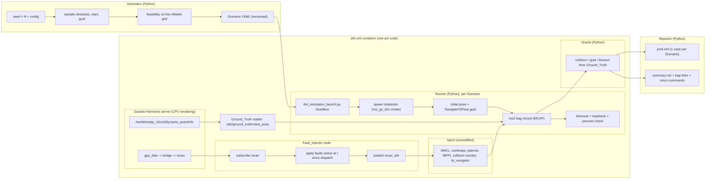

# Design Document

## Overview

Autonomy Test Harness drives Nav2 and its minimal TurtleBot 4 simulation for ROS 2 Jazzy through randomized, versioned Scenarios in Gazebo Harmonic, injects sensor Faults on a schedule, and judges each run pass or fail from simulator Ground_Truth. The harness is a Python package plus two small ROS 2 nodes:

- a **Generator** turns a seed into N feasible Scenarios;
- a **Runner** starts a clean headless Simulation per Scenario through Nav2's stock `tb4_simulation_launch.py`, spawns the Scenario's obstacles, starts the **Fault_Injector** node (which sits between the simulated lidar and Nav2), sends the goal through Nav2's `NavigateToPose` action, records a ROS_Bag, enforces a hard timeout, and tears everything down;
- a **Ground_Truth reader** node republishes the robot's true pose from Gazebo's own pose stream so it is recorded in the bag;
- an **Oracle** judges each run from that Ground_Truth, never from the robot's estimate;
- a **Reporter** writes a JUnit XML report (one test case per Scenario) and a Markdown Summary_Report.

Everything that touches ROS, Gazebo, or Nav2 runs inside one Docker image (`ath-sim`) built on the official `ros:jazzy-ros-base-noble` image, on the owner's Windows 11 PC through WSL 2's Docker Engine. Sensors render on the CPU (Mesa software rendering), so no GPU and no display are needed. A local Jenkins controller, itself a container configured entirely from files in this repository, builds the image, runs the unit tests and a 10-scenario Smoke_Suite on every change, and runs the Full_Suite nightly. The headline result is a Paired_Experiment: the same 30 Scenarios run with no Fault and under each of the six Fault types, reporting Nav2's pass rate per condition with 95% Wilson confidence intervals.

The harness tests Nav2 through its published interfaces only (topics, the `NavigateToPose` action, TF, and launch arguments) and never modifies Nav2's code. Every reported number comes from a repository script recorded with its command, seed, and full 40-character commit hash, per the portfolio rules.

**Requirements coverage:** Requirements 0–11 at a high level; detailed mappings appear per section below.

### Milestone mapping (summary)

| Milestone | Delivers | Automated gate |
| --- | --- | --- |
| Setup | Scaffold, `ath-sim` image, helper scripts, reproducibility helper | (checked by every later gate) |
| M0 | Arena world and map, Nav2 parameter file, Ground_Truth reader, headless baseline with one goal, environment evidence | `bash scripts/verify_m0.sh` |
| M1 | Scenario schema, Generator, feasibility, scenario-set CLI, committed scenario sets | `bash scripts/verify_m1.sh` |
| M2 | Injector passthrough, Runner, Oracle, 10 fixed no-Fault Scenarios run three times | `bash scripts/verify_m2.sh` |
| M3 | Fault models, scheduled Fault_Injector, one end-to-end run per Fault type | `bash scripts/verify_m3.sh` |
| M4 | JUnit and summary reports, pinned image checks, headless-render check, Smoke_Suite in the container | `bash scripts/verify_m4.sh` |
| M5 | Jenkins controller and pipeline, Paired_Experiment, generated README (Gate A) | `bash scripts/verify_m5.sh` |

Each gate is one repository command whose exit status decides pass or fail. There is no manual review stop.

---

## Platform decision (M0)

Gazebo's Windows support is not fully functional, so the Simulation runs on **Ubuntu 24.04 (Noble)** with **ROS 2 Jazzy** and **Gazebo Harmonic**, never on Windows (Requirement 1.1). The Ubuntu 24.04 environment is the project's Docker image: the official `ros:jazzy-ros-base-noble` image (Docker Official Image, Ubuntu Noble based) plus Nav2 and the minimal TurtleBot simulation from the ROS apt repository. Gazebo Harmonic arrives with the Jazzy `ros_gz` vendor packages. On this machine the image runs in Docker Engine inside WSL 2 (`Ubuntu-24.04`), so "the target machine" for every Simulation step is this PC running that image, and package-version evidence comes from `dpkg-query` inside it.

**SUT launch.** The Runner starts the SUT with `ros2 launch nav2_bringup tb4_simulation_launch.py` and these launch arguments only:

| Argument | Value | Why |
| --- | --- | --- |
| `headless` | `True` | No Gazebo GUI client (Requirement 1.3) |
| `use_rviz` | `False` | The launch file defaults it to `True`; RViz needs a display |
| `world` | `/opt/ath/worlds/empty_10x10.sdf` | The project's arena (see "World and map") |
| `map` | `/opt/ath/maps/empty_10x10.yaml` | The matching map for AMCL and the costmaps |
| `params_file` | `/opt/ath/config/nav2_params_ath.yaml` (M2 onward); the stock `nav2_params.yaml` at M0 | See "Sensor path and the parameter file" |
| `x_pose`, `y_pose`, `yaw` | the Scenario's start pose | Spawns the robot at the start |

Facts from the Jazzy branch of `navigation2` (`nav2_bringup` 1.3.14 on the branch; 1.3.13 is the latest release on index.ros.org, accessed 2026-10-17): the file declares `headless` (default `True`), `use_rviz` (default `True`), `world` (default `depot.sdf`), `map` (default `depot.yaml`), `params_file`, `robot_name` (default `nav2_turtlebot4`), and `x_pose`/`y_pose`/`z_pose`/`roll`/`pitch`/`yaw`. It starts the server with `gz sim -r -s <world>` after running the world through `xacro` with `headless:=<value>`. The stock `depot.sdf` world includes a model from Gazebo Fuel over the internet, which is one reason this project uses its own world.

**Rendering on the CPU.** The robot's lidar is a `gpu_lidar` sensor, so the Gazebo server must render even without a GUI. The container runs without GPU access (no `--gpus`), so Mesa's software rasterizer (`llvmpipe`) renders. This keeps the agent's runs and Jenkins builds identical, avoids depending on GPU graphics inside WSL containers, and leaves the GPU to other projects. The stock launch does not pass `--headless-rendering`, but gz-rendering 8 (Harmonic) falls back on its own: when it cannot open an X display it logs "Unable to open display ... Trying to run in headless mode." and switches OGRE 2 to "Headless EGL / PBuffer" (`ogre2/src/Ogre2RenderEngine.cc`, gz-rendering8 branch, accessed 2026-10-17). The method is decided once, at M0, by this rule:

1. **EGL (default):** run with `DISPLAY` unset. Pass if `~/.gz/rendering/ogre2.log` shows a renderer and `/scan` publishes at least 300 finite ranges per message in the arena.
2. **Xvfb (fallback):** if EGL fails, start `Xvfb :99` inside the container and set `DISPLAY=:99` (GLX on `llvmpipe`). Xvfb runs in the container, never on the host (Requirement 8.5).

The entrypoint script reads `ATH_RENDER_MODE` (`egl` or `xvfb`), whose default is set from the M0 outcome. Both methods are software rendering; the log's renderer string is recorded as evidence.

**Sensor path and the parameter file.** The minimal simulation's own bridge (`nav2_minimal_tb4_sim/configs/tb4_bridge.yaml`) publishes the lidar on ROS `/scan`. Nav2's stock `nav2_params.yaml` reads the lidar in four places: AMCL `scan_topic: scan`, the local costmap voxel layer `scan.topic: /scan`, the global costmap obstacle layer `scan.topic: /scan`, and the collision monitor `scan.topic: "scan"`. To put the Fault_Injector between the sensor and Nav2 without touching the simulation or Nav2's code, `scripts/make_nav2_params.py` copies the stock file from the installed `nav2_bringup` into `config/nav2_params_ath.yaml` and changes exactly those four values to `/scan_ath`, where the injector publishes. A unit test loads both files and asserts that no other value differs. The file is passed through the `params_file` launch argument (Requirement 0.10).

**Robot facts used by the harness** (from `nav2_minimal_tb4_description`, Jazzy branch): the Create 3 body radius is 0.164 m and the front bumper reaches 0.175 m, so the Oracle's footprint disk radius is 0.18 m. The RPLIDAR has 360 samples from 0 to 6.28 rad at 10 Hz, range 0.164–20 m, and is mounted rotated +90° about z, so the robot's forward direction is scan angle 270°. M0 confirms the mount yaw from TF (`base_link` to `rplidar_link`). The model has no Gazebo contact sensor, so collisions are decided geometrically (see "Oracle design"). Nav2's stock costmaps use `robot_radius: 0.22`.

> **M0 outcome (filled in by task 1.5 after the baseline runs):**
> - Confirmed package versions: `ros-jazzy-navigation2` 1.3.13-1noble.20260921.033624, `ros-jazzy-nav2-bringup` 1.3.13-1noble.20261006.042503, `ros-jazzy-nav2-minimal-tb4-sim` 1.0.1-1noble.20261006.041301, `ros-jazzy-nav2-minimal-tb4-description` 1.0.1-1noble.20260915.195305 (and `ros-jazzy-nav2-minimal-tb3-sim` 1.0.1-1noble.20261006.041307 as a dependency), recorded in `docs/ENVIRONMENT.md` with `dpkg-query` evidence (`docs/evidence/m0/dpkg_query.txt`).
> - Rendering method: **EGL** on Mesa `llvmpipe`; `ogre2.log` reports `GL_RENDERER = llvmpipe (LLVM 20.1.2, 256 bits)` through `EGL_MESA_device_software` (`docs/evidence/m0/egl/ogre2.log`), with 360 of 360 lidar ranges finite. Xvfb was not needed; the image default `ATH_RENDER_MODE` stays `egl`.
> - Headless launch evidence: `docs/evidence/m0/egl/launch.log` (`headless:=True use_rviz:=False`, no display in the container): no `[ERROR]`, dead process, or traceback before the teardown SIGINT. During teardown Nav2's component container logs errors and crashes on shutdown, which is recorded but is not part of bring-up.
> - Single-goal evidence: `bash scripts/run_m0.sh`, seed 0, commit `814a2c39bed7ff27bb2f3c8a87d1d108db3c3047`: `NavigateToPose` to (3.0, 3.0, 1.57) from (-3.0, -3.0, 0.0) returned `SUCCEEDED`; the true final pose was 0.1358 m from the goal (tolerance 0.30 m), yaw error 0.1895 rad (`results/m0_baseline.json`).
> - Lidar mount yaw from TF: +90.0° (`base_link` to `rplidar_link`), so forward is scan bearing 270°.
> - Robot model name: Gazebo lists the robot as `turtlebot4`, not `nav2_turtlebot4`: the stock spawn passes `-entity nav2_turtlebot4`, but `ros_gz_sim create` with `-topic robot_description` takes the URDF's robot name. The Ground_Truth reader, the readiness check, and `config/run.yaml` use `turtlebot4`.
> - If M0 fails: _the failing step and its observed effect are recorded in `docs/ENVIRONMENT.md`, and later milestones do not run (Requirement 1.5)._ M0 passed.

**Requirements coverage:** Requirement 1 (1.1–1.5), 0.10.

---

## Architecture



**Requirements coverage:** Requirements 2–7 (end-to-end data path), 4.1 (injector between the sensor and Nav2), 6.1 (Oracle reads Ground_Truth).

---

## Execution environment (where the tasks run)

Kiro runs every task on the owner's Windows 11 desktop. Git and `gh` run on Windows; everything else runs in WSL 2 (`Ubuntu-24.04`), and everything that touches ROS, Gazebo, Nav2, or the harness's Python code runs inside the `ath-sim` image.

| Item | Value |
| --- | --- |
| Repository root | `C:\dev\Autonomy-Test-Harness` (WSL path `/mnt/c/dev/Autonomy-Test-Harness`) |
| GitHub | `https://github.com/OctaviusLeo/Autonomy-Test-Harness`, private |
| Simulation image | `ath-sim:dev` (latest working tree) and `ath-sim:<40-character commit>` (built from a clean commit, used for every reported run) |
| Shared directory | `~/ath-shared` (`ATH_SHARED`): `sim.lock`, `runs/<run_id>/` (bags, logs, run records), `jenkins/<build tag>/` |
| Jenkins | Compose project `ath-jenkins`, container `ath-jenkins`, image `ath-jenkins:local`, volume `ath_jenkins_home`, UI at `http://127.0.0.1:8091` (anonymous read-only) |
| Jenkins admin password | `~/.config/ath/jenkins.env` (mode 600), generated by `scripts/jenkins_up.sh`; never printed or committed |
| Host tools | bash, Docker CLI and Compose, `flock`, `curl`, and `uv` (only for `uv lock`); no Python environment on the host |
| Helper scripts | `scripts/wsl_run.sh`, `scripts/bg.sh`, `scripts/bg_status.sh`, `scripts/sim_lock.sh` (exactly as in `.kiro/steering/environment.md`) |

**Rules that keep an unattended run safe and repeatable**
- **Commands:** run every WSL command from PowerShell through `wsl -d Ubuntu-24.04 -- bash /mnt/c/dev/Autonomy-Test-Harness/scripts/wsl_run.sh <command>`. Anything with `$`, pipes, `&&`, redirection, or nested quotes goes into a script under `scripts/`. Shell scripts run as `bash scripts/<name>.sh`. `.gitattributes` holds `* text=auto eol=lf` plus `*.png binary` and `*.pgm binary`.
- **One heavy job at a time.** Image builds, unit-test runs in the image, suites, the experiment, and every heavy Jenkins stage run under one host-wide lock, `flock ~/ath-shared/sim.lock`, through `scripts/sim_lock.sh`. The Jenkins container sees the same file at the same path, so the agent's runs and Jenkins builds never overlap and never compete for CPU while results are measured. A script that already holds the lock sets `ATH_LOCK_HELD=1` so nested scripts do not wait on themselves.
- **Long jobs run detached with polling.** Kiro stops a single command after at most 30 minutes. Anything that may take longer than 10 minutes starts with `bash scripts/bg.sh <name> <command>` and is polled with `bash scripts/bg_status.sh <name>`: image builds, the M0 baseline, every suite, the experiment, and waiting for a Jenkins build. Once Jenkins runs, every command that takes the lock is started this way, because a build may hold the lock for 30 minutes or more. A job reported `LOST` is an environment failure recorded in `docs/BLOCKERS.md`.
- **No GPU and no display.** The image runs without `--gpus` and with no host display; the GPU is never needed.
- **Container options.** Every simulation container runs with `--shm-size=1g`, because Fast DDS uses shared memory and Docker's default is 64 MB, and with no `DISPLAY` variable or X socket passed in. Containers run as root, so each script that mounts an output directory hands it back to the calling user (`chown -R` from a short container run) when it finishes.
- **No `sudo`.** Docker Engine and the Compose plugin were installed by the owner. A missing system package on the host is a blocker. Packages inside the image are installed by its Dockerfile.
- **Docker scope:** only containers, images, Compose projects, and volumes whose names start with `ath` may be created, started, stopped, or removed. Other projects' containers (for example `gqa` and `fts`) are never touched. Never run `docker system prune`, `docker image prune`, `docker volume rm`, `wsl --shutdown`, or `wsl --terminate`.
- **Numbers come from committed code.** Before any run whose numbers are reported, commit, build `ath-sim:<commit>` with `scripts/build_image.sh`, and pass the commit into the container as `ATH_COMMIT`. `scripts/require_clean.sh` refuses a reported run when `git --no-optional-locks status --porcelain` shows changes outside `results/`, `runs/`, `docs/`, `ci/jenkins_run_log/`, `README.md`, and `.kiro/` (Kiro updates the task list while a task runs).
- **Retry cap.** A gate or verification that still fails after 3 fix attempts for the same cause is recorded in `docs/BLOCKERS.md` (task, command, exit code, log path, suspected cause), and that task stops. Targets, thresholds, time limits, and tests are never loosened to pass (Requirement 0.4).

**Requirements coverage:** 0.1, 0.4, 0.8, 5.2, 8.5, 9.1.

---

## Repository layout

The repository remote is `https://github.com/OctaviusLeo/Autonomy-Test-Harness.git` (private; no public license, packaging, or releases, per the portfolio rules).

```
Autonomy-Test-Harness/
├── harness/                      # Python package, installed editable in the image at /opt/ath
│   ├── repro.py                  # commit hash, Stamp {command, seed, commit}, serializer
│   ├── nav2_params.py            # stock nav2_params.yaml -> config/nav2_params_ath.yaml (four topic names)
│   ├── m0.py                     # M0 baseline logic (scripts/m0_baseline.py is its entry point)
│   ├── render_check.py           # headless-render check logic (scripts/check_headless_render.sh)
│   ├── world/arena.py            # arena geometry -> world SDF + map PGM/YAML + Oracle wall shapes
│   ├── schema/scenario.py        # Scenario model, bounds, supported versions and worlds
│   ├── schema/validate.py        # load_scenario (field-level errors), dump_scenario (deterministic YAML)
│   ├── generator/generate.py     # generate(seed, n, config), generate_one(seed, config)
│   ├── generator/feasibility.py  # inflated occupancy grid, BFS reachability, rejection reasons
│   ├── generator/cli.py          # generate a set, regenerate one Scenario from its seed
│   ├── faults/models.py          # pure fault functions
│   ├── faults/schedule.py        # pure window logic: which faults are active at t
│   ├── faults/injector_node.py   # ROS 2 node: /scan -> faults -> /scan_ath
│   ├── runner/gt_bridge.py       # ROS 2 node: Gazebo pose stream -> /ath/ground_truth/robot_pose
│   ├── runner/processes.py       # process-group launch, kill, leftover check (injectable for tests)
│   ├── runner/run_scenario.py    # one Scenario's lifecycle -> RunRecord
│   ├── runner/suite.py           # a set of Scenarios with hard wall-clock limits -> RunRecords
│   ├── oracle/geometry.py        # footprint-to-shape distances
│   ├── oracle/judge.py           # Verdict from Ground_Truth samples
│   ├── oracle/bag_reader.py      # Ground_Truth samples from the bag (rosbag2_py)
│   ├── reporting/junit.py        # JUnit XML writer
│   ├── reporting/summary.py      # Markdown summary writer
│   ├── experiment/stats.py       # Wilson interval
│   ├── experiment/conditions.py  # apply_condition: base Scenario + one condition's Fault
│   └── experiment/paired.py      # paired experiment driver
├── worlds/empty_10x10.sdf        # generated by scripts/build_world.py, committed
├── maps/empty_10x10.{pgm,yaml}   # generated by scripts/build_world.py, committed
├── scenarios/fixed10/            # 10 no-Fault Scenarios (the Smoke_Suite), committed
├── scenarios/experiment30/       # 30 base Scenarios for the Paired_Experiment, committed
├── config/
│   ├── generator.yaml            # experiment generator config
│   ├── generator_smoke.yaml      # Smoke_Suite generator config
│   ├── faults.yaml               # fault parameter defaults
│   ├── experiment.yaml           # the seven experiment conditions
│   ├── run.yaml                  # tolerances, thresholds, timeouts, topics
│   └── nav2_params_ath.yaml      # generated by scripts/make_nav2_params.py
├── docker/Dockerfile, docker/apt-pins.txt, docker/entrypoint.sh, .dockerignore
├── ci/Jenkinsfile
├── ci/jenkins/                   # Dockerfile, plugins.txt, casc.yaml, docker-compose.yml
├── ci/jenkins_run_log/           # committed log of one successful Jenkins run
├── scripts/                      # thin entry points and shell helpers
├── results/                      # generated reports and run records (never hand-edited)
├── docs/ENVIRONMENT.md, docs/README.template.md, docs/BLOCKERS.md (only if a blocker occurs)
├── tests/                        # pytest + Hypothesis
├── THIRD_PARTY.md                # repository root, matching the requirements glossary
├── pyproject.toml, uv.lock
└── README.md                     # generated by scripts/build_docs.py
```

`THIRD_PARTY.md` lives at the repository root because the requirements' glossary names that path; the earlier run's `docs/THIRD_PARTY.md` moves there. Bags and logs stay in `~/ath-shared/runs/` and are never committed.

**Requirements coverage:** 0.5, 0.7, 0.8, 0.9; 7.4, 8.1, 9.5, 11.1.

---

## Components and interfaces

### World and map (`harness/world/arena.py`)
- **Responsibility:** one definition of the arena that produces the Gazebo world, the Nav2 map, and the wall shapes the Oracle and Generator use, so all three agree by construction.
- **Interface:** `arena(world_id) -> Arena` (walls as oriented rectangles, map bounds); `write_world_sdf(arena, path)`; `write_map(arena, pgm_path, yaml_path)`; `scripts/build_world.py` writes `worlds/empty_10x10.sdf` and `maps/empty_10x10.{pgm,yaml}`.
- **Contract:** the map frame equals the world frame (the map YAML's origin is chosen so that map coordinates are Gazebo world coordinates), so Ground_Truth, Scenario poses, and AMCL share one frame (Requirement 2.6).
- **Requirements:** 2.5, 2.6, 3.6, 6.2.

### Scenario schema (`harness/schema/`)
- **Responsibility:** define and validate the versioned Scenario.
- **Interface:** `load_scenario(path) -> Scenario`; `dump_scenario(scenario) -> str` (deterministic YAML: fixed key order, floats rounded to 4 decimals); `Scenario` carries `schema_version`, `scenario_id`, `seed`, `world`, `start`, `goal`, `obstacles[]`, `faults[]`, `time_limit_s`.
- **Contract:** unsupported `schema_version` is rejected naming the version (Requirement 2.3); a missing field, out-of-bound value, wrong type, unknown field, unsupported `world`, or unsupported Fault `type` is rejected naming the field (Requirement 2.4); YAML is read by the Generator, Runner, and Oracle without conversion (Requirement 2.5); all poses are in the map frame (Requirement 2.6). The earlier run's pydantic v2 schema is kept and brought in line: `world` is limited to supported worlds, and the optional `odom_drift` type is removed because it is not implemented (see "Fault models").
- **Requirements:** 2.1–2.6.

### Generator (`harness/generator/`)
- **Responsibility:** produce N feasible Scenarios from a seed.
- **Interface:** `generate(seed, n, config) -> GenerationResult` (Scenarios plus rejection counts by reason); `generate_one(scenario_seed, config, scenario_id) -> (Scenario, rejections)`; `is_feasible(scenario, grid) -> (bool, reason)`.
- **Contract:** randomized obstacles, start, and goal from the seed (Requirement 3.1); the same seed and config give byte-identical YAML (Requirement 3.2); infeasible draws are rejected and replaced so exactly N are returned (Requirement 3.3); rejection counts by reason are recorded (Requirement 3.4); each Scenario stores its own seed and `generate_one` on that seed reproduces it exactly (Requirements 3.5, 5.6); reachability is the BFS check defined below (Requirement 3.6).
- **Requirements:** 3.1–3.6, 0.2, 0.3.

### Fault injector (`harness/faults/`)
- **Responsibility:** apply scheduled sensor Faults between the simulated lidar and Nav2.
- **Interface:** pure functions in `models.py` (`apply_range_noise`, `apply_ray_dropout`, `apply_latency` (a `LatencyQueue`), `apply_freeze` (a `FreezeState`), `apply_sector_blackout`, and whole-scan dropout as a drop decision), each over a scan (ranges, angle_min, angle_increment, range_min, range_max, stamp), params, and a seeded RNG; `schedule.py` decides which Faults are active at run time t; `injector_node.py` subscribes to `/scan`, applies the active Faults, and publishes `/scan_ath`.
- **Contract:** the node sits between the sensor and Nav2 without modifying the SUT (Requirement 4.1); each Fault applies only inside its window and the stream passes through unchanged outside every window (Requirement 4.2); the six required Faults are supported (Requirement 4.3); measured effects match configured values within the stated tolerances (Requirements 4.4, 4.5, 4.7); whole-scan dropout publishes nothing in-window (4.6); freeze republishes the last pre-window scan unchanged (4.8); sector blackout marks in-sector rays no-return and leaves the rest unchanged (4.9); odometry drift is not implemented, for the reason recorded below (4.10); each Fault has a unit test (4.11).
- **Requirements:** 4.1–4.11.

### Ground_Truth reader (`harness/runner/gt_bridge.py`)
- **Responsibility:** put the robot's true pose into the bag.
- **Interface:** a ROS 2 node that runs `gz topic -e -t /world/<world>/dynamic_pose/info --json-output` (gz-transport 13 prints one protobuf-JSON message per line) and publishes `geometry_msgs/PoseStamped` on `/ath/ground_truth/robot_pose` for the robot's model, stamped with the message's simulation time, frame `map`.
- **Contract:** the pose stream comes from Gazebo's `SceneBroadcaster` system, which the arena world loads; it is the simulator's state, not the robot's estimate (Requirement 6.1). In protobuf JSON, 64-bit integers appear as strings and zero values are omitted; the parser treats missing fields as zero. If the JSON path does not work at M0, the fallback is a `ros_gz_bridge` mapping of the same Gazebo topic to `tf2_msgs/TFMessage`, taking the only dynamic model's entry, and the choice is recorded.
- **Requirements:** 5.5, 6.1.

### Runner (`harness/runner/`)
- **Responsibility:** execute each Scenario cleanly end to end.
- **Interface:** `run_scenario(scenario, run_config, out_dir, run_index) -> RunRecord`; `run_suite(scenarios, run_config, out_dir) -> list[RunRecord]`; host scripts `scripts/run_suite.sh <suite>` and `scripts/rerun_one.sh`.
- **Contract:** per Scenario, start a clean headless Simulation and Nav2, spawn obstacles, start the injector, send the goal, record a bag (Requirement 5.1); tear everything down and confirm no process remains (5.2); enforce a hard timeout and continue (5.3); name the bag by `scenario_id` (5.4); hand Ground_Truth and metadata to the Oracle (5.5); re-run one Scenario from its seed (5.6); on a launch, spawn, or goal failure, mark the Scenario errored with the failing step and continue (5.7).
- **Requirements:** 5.1–5.7.

### Oracle (`harness/oracle/`)
- **Responsibility:** judge each run from Ground_Truth.
- **Interface:** `judge(gt_samples, dispatch_time, scenario, arena, thresholds, nav2_result) -> Verdict` (pure); `bag_reader.read_ground_truth(bag_path) -> samples`.
- **Contract:** uses Ground_Truth only (Requirement 6.1); collision when footprint-to-obstacle distance drops below the threshold (6.2; the robot model has no contact sensor, so the contact clause never triggers and this is recorded); goal reached within both tolerances (6.3); pass only when the goal is reached within the time limit without collision (6.4); "timeout" when it is not reached in time (6.5); records Verdict, Time_To_Goal, minimum distance, and reason (6.6); unit-tested on constructed inputs (6.7).
- **Requirements:** 6.1–6.7.

### Reporter (`harness/reporting/`)
- **Responsibility:** generate the JUnit and summary reports.
- **Interface:** `write_junit(run_records, path, suite_name)`; `write_summary(run_records, path, bag_link_base, rerun_template)`.
- **Contract:** one test case per Scenario, failed cases carry the reason, errored cases are errored (Requirement 7.1); the summary states pass rate per Fault type, each failure's reason, and a link to each failed run's bag (7.2) and its exact re-run command with seed (7.3); both are generated, never hand-edited (7.4); missing or unparsable input stops generation without a partial file and names the bad input (7.5).
- **Requirements:** 7.1–7.5.

### Paired experiment (`harness/experiment/`)
- **Responsibility:** produce the headline result.
- **Interface:** `wilson_interval(passes, n, z) -> (low, high)`; `apply_condition(scenario, condition) -> Scenario`; `run_paired(base_scenarios, conditions, run_config, out_dir) -> ExperimentReport`.
- **Contract:** the same 30 Scenarios run under all seven conditions (Requirement 10.1); pass rate per condition with a 95% Wilson interval (10.2); total run time reported (10.3); one command, fixed seed, recorded command, seed, and commit (10.4); real rates reported without loosening anything (10.5).
- **Requirements:** 10.1–10.5.

### Reproducibility helper (`harness/repro.py`)
- **Responsibility:** stamp every reported number.
- **Interface:** `commit_hash()` returns `ATH_COMMIT` when set (inside the image, where there is no `.git`) and otherwise `git rev-parse HEAD`; `Stamp(command, seed, commit)`; `stamp_json(obj, stamp)`. The clean-tree refusal lives in `scripts/require_clean.sh` on the host, which runs before any reported run starts.
- **Requirements:** 0.1, 0.2.

**Requirements coverage:** Requirements 2–7, 10, 0.1, 0.2.

---

## World and map

**World `empty_10x10`:** a 10 m × 10 m free interior (x and y from −5.0 to 5.0 m) enclosed by four walls 0.2 m thick and 1.0 m high, with no interior features ("empty" means no fixed obstacles; the Scenario's obstacles are spawned at run time). The world file loads the same systems as the stock `depot.sdf` (`Physics`, `UserCommands`, `Sensors` with `<render_engine>ogre2</render_engine>`, `Imu`) plus `SceneBroadcaster`, which publishes the pose stream the Ground_Truth reader uses, and keeps the stock world's physics block (`max_step_size` 0.003, `real_time_factor` 1.0). It declares `<xacro:arg name="headless" default="true"/>` because the stock launch runs every world through `xacro`. It references no Gazebo Fuel model, so a run needs no network.

**Map:** resolution 0.05 m, covering x and y from −5.5 to 5.5 m (220 × 220 cells), origin `[-5.5, -5.5, 0.0]`, trinary mode. Interior cells are free (254); walls and everything outside them are occupied (0). Because the origin is set this way, map coordinates equal world coordinates.

**Obstacles:** spawned after the server starts with `ros2 run ros_gz_sim create -world empty_10x10 -file <obstacle .sdf> -name obs_<k> -x -y -z -Y`, as static models (box or cylinder, collision and visual). Each obstacle's height is at least 0.5 m so the lidar sees it. Obstacles are not in the map: Nav2 must detect them with the lidar, which is what makes sensor Faults matter.

**Requirements coverage:** 2.5, 2.6, 3.6, 5.1.

---

## Scenario schema and example

The Scenario is YAML with a mandatory `schema_version`. All poses are in the **map frame** (REP 105 `map`, identical to the world frame here), meters and radians (Requirement 2.6). Fault windows are in seconds of simulation time after the goal is dispatched.

```yaml
schema_version: 1                 # unsupported versions are rejected by name (Req 2.3)
scenario_id: exp30-007
seed: 1733220917                  # this Scenario's own seed; regenerates it alone (Req 3.5)
world: empty_10x10                # must be a supported world (Req 2.1)
time_limit_s: 90.0                # simulation seconds after goal dispatch (Req 5.3, 6.5)
start: {x: -3.2, y: -2.75, yaw: 0.4}
goal:  {x: 2.9, y: 1.85, yaw: -2.1}
obstacles:                        # each: shape, size, pose (Req 2.2)
  - {shape: box, size: {x: 0.5, y: 0.4, z: 0.8}, pose: {x: 0.1, y: -0.3, yaw: 0.7}}
  - {shape: cylinder, size: {radius: 0.3, height: 0.6}, pose: {x: 1.5, y: -1.0, yaw: 0.0}}
faults:                           # each: type, window, params (Req 2.1, 4.2, 4.3)
  - {type: sector_blackout, window: {start_s: 5.0, end_s: 65.0}, params: {center_deg: 270.0, width_deg: 90.0}}
```

**Bounds (enforced in validation, Requirement 2.4):** `schema_version` ∈ {1}; `world` ∈ {`empty_10x10`}; `time_limit_s` > 0; obstacle sizes > 0; fault `window.end_s` > `window.start_s` ≥ 0; `sigma_m` ≥ 0; `prob` in [0, 1]; `latency_ms` in [0, 1000]; sector `width_deg` in (0, 360] and `center_deg` in [0, 360); unknown fields rejected. Any violation is rejected naming the offending field.

**Requirements coverage:** Requirement 2 (2.1–2.6).

---

## Generator algorithm

All randomness flows from seeds through `numpy.random.default_rng` (Requirement 3.2). For a set:

1. A set RNG seeded with the set seed draws one 31-bit **Scenario seed** per Scenario, in order.
2. For each Scenario, `generate_one(scenario_seed, config, scenario_id)` uses only its own RNG, seeded with that Scenario seed. It repeats until a feasible draw:
   - **sample obstacles:** a count in `[obstacle_count.min, obstacle_count.max]`, then per obstacle a shape (box or cylinder, equal odds), size within the configured ranges, and a pose within `sample_bounds`;
   - **sample start and goal:** a start pose within `sample_bounds` with uniform yaw; then a goal pose within `sample_bounds` whose distance from the start is within `start_goal_distance_m`, with uniform yaw (redrawn until the distance fits; this is a sampling rule, not a rejection);
   - **feasibility (Requirements 3.3, 3.6):** build an occupancy grid at `grid_resolution_m` from the arena's walls plus the sampled obstacles, inflated by `robot_radius_m + clearance_m`. Reject and count by reason if:
     - **start inside obstacle:** the start cell is occupied;
     - **off map:** the start or goal lies outside the map;
     - **unreachable:** a 4-connected breadth-first flood fill from the start cell does not reach the goal cell (a goal inside an inflated obstacle is unreachable).
3. Rejected draws are replaced from the same RNG until the Scenario is feasible (at most 1,000 attempts, then an error naming the Scenario seed), so exactly N Scenarios are returned with rejection counts by reason (Requirements 3.3, 3.4).
4. Each Scenario is written with its own seed, so `generate_one` on that seed alone reproduces it exactly (Requirements 3.5, 5.6).

The occupancy-grid connectivity check is the definition of "unreachable" used everywhere; it is a necessary condition for Nav2 to succeed, stated here so the term is testable (Requirement 3.6).

**Committed sets.** `scenarios/fixed10/` comes from `config/generator_smoke.yaml` (set seed 101, N = 10) and is the Smoke_Suite. `scenarios/experiment30/` comes from `config/generator.yaml` (set seed 303, N = 30) and is the experiment's base set. Each set directory holds the Scenario files and a stamped `generation.json` (command, set seed, commit, rejection counts by reason).

**Requirements coverage:** Requirement 3 (3.1–3.6), 0.2, 0.3.

---

## Fault models

Each Fault is a pure function over a scan, its params, and a seeded RNG, so it is unit-testable without the simulator. A ray's **bearing** is `angle_min + i × angle_increment` in the scan's own frame, in degrees normalized to [0, 360). **No-return** is `+inf`, the ROS convention for "no detection" (REP 117).

- **Range noise (Requirement 4.4):** for each finite range, `r_out = r_in + e`, `e ~ N(0, sigma²)`, then clipped to [`range_min`, `range_max`]. Over at least 1,000 affected returns away from the limits, the sample standard deviation of `(r_out − r_in)` recovers `sigma` within ±10%.
- **Per-ray dropout (Requirement 4.5):** ray i becomes no-return iff `u_i < p`, `u_i ~ Uniform[0, 1)`. Over at least 1,000 affected rays, the dropped fraction is within ±2 percentage points of `p`.
- **Whole-scan dropout (Requirement 4.6):** publish nothing while the window is active; resume after.
- **Added latency (Requirement 4.7):** queue each scan with its arrival time (simulation clock) and publish it unchanged at the first check where `arrival + L ≤ now`. The node checks the queue at 200 Hz of simulation time, so the release error is at most 5 ms. Over at least 100 affected messages, the measured delay matches `L` within ±20%. Because the release error can reach 5 ms, the ±20% criterion is meaningful for `L` of at least 25 ms; Property 8 is tested over 25-1000 ms, and the experiment uses 300 ms.
- **Frozen scan (Requirement 4.8):** keep the last scan received before the window; while the window is active, publish that scan unchanged (same header) each time a new scan arrives.
- **Blacked-out sector (Requirement 4.9):** a ray whose bearing lies within `width_deg / 2` of `center_deg` (circular distance) becomes no-return; every other ray is unchanged.
- **Odometry drift (Requirement 4.10): not implemented.** The odometry and the `odom` to `base_link` transform come from Gazebo's DiffDrive system through the simulation's own bridge; intercepting them would mean changing the simulation's bridge configuration or remapping TF, which changes the SUT's wiring rather than its published interfaces (Requirement 0.10). The schema therefore rejects `odom_drift`.

**Scheduling:** the Runner publishes the goal-dispatch simulation time on `/ath/goal_dispatch` (`builtin_interfaces/msg/Time`, transient-local). Before it arrives, the injector passes scans through. Afterwards, for t = now − dispatch, a Fault is active iff `start_s ≤ t < end_s`. The injector publishes the active Fault types on `/ath/faults/active` (a JSON string per scan) for the bag.

**Determinism:** each Fault's RNG is seeded with `[scenario.seed, fault_index]` through `numpy.random.SeedSequence`, so Faults do not perturb one another and a re-run reproduces every draw (Requirements 0.2, 0.3).

**Experiment conditions** (`config/experiment.yaml`; each adds one Fault to every base Scenario, with defaults from `config/faults.yaml`, set before any run):

| Condition | Params | Window (s after dispatch) |
| --- | --- | --- |
| `none` | no Fault | — |
| `range_noise` | `sigma_m: 0.10` | 5–65 |
| `ray_dropout` | `prob: 0.5` | 5–65 |
| `scan_dropout` | none | 5–15 |
| `latency` | `latency_ms: 300` | 5–65 |
| `freeze` | none | 5–15 |
| `sector_blackout` | `center_deg: 270` (robot forward, from the lidar's +90° mount; M0 confirms it from TF), `width_deg: 90` | 5–65 |

The values are chosen to be strong enough to plausibly change outcomes while staying inside the schema's bounds. They are fixed before the experiment and never changed to alter a result (Requirement 10.5).

**Requirements coverage:** Requirement 4 (4.1–4.11), 0.2, 0.3, 10.1.

---

## Runner design

A suite runs inside **one** `ath-sim` container (`docker run` from `scripts/run_suite.sh` under the simulation lock, with `~/ath-shared/runs/<run_id>/` mounted at `/results`). Inside it, `harness.runner.suite` runs each Scenario in a child Python process with a hard wall-clock limit. Each Scenario's lifecycle (`harness.runner.run_scenario`) is:

1. **Isolate:** a fresh `ROS_DOMAIN_ID` (1 + run index mod 100), `ROS_AUTOMATIC_DISCOVERY_RANGE=LOCALHOST`, and `GZ_PARTITION=ath_<run index>`, so a leftover process from an earlier run cannot talk to this one.
2. **Launch** `tb4_simulation_launch.py` with the arguments in "Platform decision", in a new process group, logging to `launch.log`. Ready means `gz model --list` lists the robot model (`turtlebot4`, see "M0 outcome") and `/scan` publishes. Not ready within `startup_timeout_s` marks the run errored with step `launch` (Requirement 5.7).
3. **Spawn** each obstacle with `ros_gz_sim create`; a non-zero exit, or a model missing from `gz model --list`, marks the run errored with step `spawn`.
4. **Start** the Ground_Truth reader, the Fault_Injector with the Scenario's Faults, and `ros2 bag record --use-sim-time` (MCAP storage, `zstd_fast` preset, so receive times are simulation time) to `bags/<scenario_id>/`, recording `/scan`, `/scan_ath`, `/odom`, `/tf`, `/tf_static`, `/cmd_vel`, `/amcl_pose`, `/plan`, `/ath/ground_truth/robot_pose`, `/ath/goal_dispatch`, `/ath/faults/active`, and `/navigate_to_pose/_action/status`. Camera topics are not recorded (Requirement 5.4).
5. **Initial pose:** `nav2_simple_commander`'s `BasicNavigator.setInitialPose` with the start pose, then `waitUntilNav2Active()`; a timeout marks the run errored with step `nav2_activate`.
6. **Goal:** `goToPose` with the goal; a rejected goal marks the run errored with step `goal`. On acceptance, publish the dispatch time on `/ath/goal_dispatch`.
7. **Run** until the action finishes or `time_limit_s` of simulation time passes (then cancel the goal), and record 2 more simulation seconds.
8. **Teardown (Requirement 5.2):** stop the bag, the nodes, and the launch process group (SIGINT, then SIGKILL after 10 s); then `pgrep` for `gz sim`, `parameter_bridge`, `image_bridge`, `component_container`, `robot_state_publisher`, `ros2`, `injector_node`, and `gt_bridge`. Any survivor is killed and recorded in the RunRecord as `leftover_processes`; the suite does not start the next Scenario until none remain. Fast DDS shared-memory files in `/dev/shm` are removed.
9. **Judge:** read Ground_Truth from the bag and call the Oracle (Requirement 5.5). Write `run_record.json` and `verdict.json`.

**Hard timeout (Requirement 5.3):** the suite kills a Scenario's child process after `startup_timeout_s + 3 × time_limit_s + 60` wall-clock seconds, runs the teardown check, marks the run `timed_out` with Verdict fail and reason `"timeout"` (detail "hard wall-clock limit"), and continues.

**Re-run one Scenario (Requirement 5.6):** `bash scripts/rerun_one.sh --config <generator config> --seed <scenario seed> [--condition <name>]` regenerates the Scenario with `generate_one`, confirms it equals the stored file, and runs it alone with the same Runner.

**Errored, hung, or stalled runs:** a run without a Verdict of its own (errored, or stopped by the hard limit or by a stall) is retried once with the other render method, and both attempts are recorded; a run that failed its Verdict is never re-run (see "Stall and crash handling"). Gate A requires that every experiment run has a Verdict.

**Requirements coverage:** Requirement 5 (5.1–5.7).

---

## Oracle design

The Oracle reads only Ground_Truth: the true robot pose samples on `/ath/ground_truth/robot_pose`, the Scenario's obstacles, and the arena's walls (Requirement 6.1). Thresholds come from `config/run.yaml`:

| Setting | Value | Reason |
| --- | --- | --- |
| `footprint_radius_m` | 0.18 | Create 3 body 0.164 m, bumper front 0.175 m |
| `collision_threshold_m` | 0.02 | Clearance below 2 cm counts as contact |
| `goal_position_tol_m` | 0.30 | Nav2's goal checker uses 0.25 m on its own estimate; 0.05 m allows for the estimate-to-truth gap |
| `goal_orientation_tol_rad` | 0.30 | Nav2's 0.25 rad plus 0.05 rad, for the same reason |

These are fixed before any run and never changed to alter a result (Requirement 0.4).

- **Collision (Requirement 6.2):** for each sample after dispatch, the clearance is the distance from the robot center to each obstacle or wall shape (oriented rectangle or circle) minus `footprint_radius_m`. A Collision is recorded if the minimum clearance over the run drops below `collision_threshold_m`. The TurtleBot 4 model has no Gazebo contact sensor, so the "contact sensor reports contact" clause cannot trigger; this is stated in the README's limitations.
- **Goal_Reached (Requirement 6.3):** the first sample at which the true position is within `goal_position_tol_m` and the true yaw within `goal_orientation_tol_rad` of the goal.
- **Verdict (Requirements 6.4, 6.5):** pass iff Goal_Reached happens within `time_limit_s` after dispatch and no Collision occurs; otherwise fail. Reason `"collision"` takes precedence; otherwise `"timeout"` (goal not reached within the limit). The `detail` field records Nav2's action result (`SUCCEEDED`, `ABORTED`, `CANCELED`) and the end time, so "Nav2 reported success but the robot was not at the goal" is visible.
- **Metrics (Requirement 6.6):** Verdict, `time_to_goal_s` (null if not reached), `min_clearance_m` (footprint to any obstacle or wall), reason, and detail for every run.

**Requirements coverage:** Requirement 6 (6.1–6.7).

---

## Reports

The Reporter consumes RunRecords and writes two generated artifacts (never hand-edited, Requirement 7.4):

- **JUnit XML (`junit.xml`):** one `<testsuite>` per suite or experiment condition, one `<testcase>` per Scenario named by `scenario_id` (with `[condition]` appended in the experiment); a failed run adds `<failure message="collision|timeout">detail</failure>`; an errored run adds `<error message="errored: <step>">`. Jenkins renders each Scenario as a test case (Requirements 7.1, 9.4).
- **Summary (`summary.md`):** pass rate per Fault type (`none` for no Fault), a table of failed Scenarios with reason and detail, a Markdown link to each failed run's bag (a path under `~/ath-shared/runs/` locally, or the archived artifact URL in Jenkins), and each failed Scenario's exact `scripts/rerun_one.sh` command with its seed (Requirements 7.2, 7.3), plus the stamp.

Missing or unparsable input stops generation without writing a partial file (output is written to a temporary file and renamed only on success) and emits an error naming the bad input (Requirement 7.5).

**Requirements coverage:** Requirement 7 (7.1–7.5).

---

## Docker image and headless rendering

`docker/Dockerfile` (Requirements 8.1, 8.4):

- `FROM ros:jazzy-ros-base-noble@sha256:<digest>`, the official image pinned by the digest resolved at setup and recorded in `docs/ENVIRONMENT.md`. On 2026-10-17 the tag existed on Docker Hub, updated that day.
- `apt-get install` of exact versions listed in `docker/apt-pins.txt`: `ros-jazzy-nav2-bringup` (which depends on `navigation2`, both minimal TurtleBot simulations, `ros_gz_sim`, and `ros_gz_bridge`), `ros-jazzy-nav2-minimal-tb4-sim`, `ros-jazzy-nav2-minimal-tb4-description`, `ros-jazzy-nav2-simple-commander`, `ros-jazzy-rosbag2-storage-mcap`, `git`, `procps`, `xvfb`, `libegl1`, `libegl-mesa0`, `libgl1-mesa-dri`, and `mesa-utils`. `scripts/resolve_apt_pins.sh` fills in each version by running `apt-cache policy` inside the pinned base image. `scripts/check_dockerfile_pins.py` (with tests) fails if the base is not digest-pinned or if any installed package lacks an exact version.
- `uv` copied from `ghcr.io/astral-sh/uv:<version>` (the version the host uses), a virtual environment at `/opt/venv` created with `--system-site-packages` so ROS's Python packages stay importable, and `uv sync --frozen` from the committed `uv.lock`. The harness is installed editable at `/opt/ath`.
- `docker/entrypoint.sh` sources `/opt/ros/jazzy/setup.bash`, adds `/opt/ath/worlds` to `GZ_SIM_RESOURCE_PATH`, applies `ATH_RENDER_MODE`, and runs the command.
- `.dockerignore` excludes `.git`, `runs/`, `.kiro/`, caches, and `results/`.

**Reproducibility limit:** the ROS apt repository keeps only each package's current version, so a pinned version disappears after the next ROS sync. A rebuild then fails loudly at `apt-get` instead of drifting. `scripts/resolve_apt_pins.sh` re-resolves the pins, and the built image's digest is recorded for every reported run. ROS snapshot repositories (`snapshots.ros.org`) exist for LTS distributions but were reported months behind in 2026, so they are not relied on.

**Headless rendering (Requirements 8.2, 8.3, 8.5):** the method chosen at M0 (EGL or Xvfb, both CPU software rendering) is stated in `docs/ENVIRONMENT.md`. `scripts/check_headless_render.sh` runs in the container with no display attached: it starts the arena world with one 1.0 m box placed 2.0 m in front of the lidar, reads one `/scan`, and checks that the beam toward the box measures the expected distance within 0.05 m and that at least 300 ranges are finite. It records its exact command and output in `results/headless_render_check.txt`.

> **Headless-rendering outcome (filled in by task 5.4 after the check runs in the container):**
> - Method: **EGL, headless, on Mesa's `llvmpipe`** (CPU software rendering), chosen at M0; no display and no X socket in the container (`ATH_RENDER_MODE=egl`, `DISPLAY` unset).
> - Evidence: `bash scripts/check_headless_render.sh` (seed 0, commit `eab421795f3efad6cf9e0ef2269c98b714bc47ed`) → `results/headless_render_check.txt`: PASS. A 1.0 m box with its near face 2.0 m ahead of the lidar measured 2.0009 m on the forward beam (bearing 269.613°, tolerance 0.05 m); 360 of 360 ranges finite; renderer `llvmpipe (LLVM 20.1.2, 256 bits)`.
> - Pinned versions: base `ros:jazzy-ros-base-noble@sha256:103b6c417973394659af6804d4917cd489b91e5ed22eb7bef263025a3bed2410` and every line of `docker/apt-pins.txt`, recorded in `docs/ENVIRONMENT.md` ("Docker image") and checked by `python scripts/check_dockerfile_pins.py`.

**Requirements coverage:** Requirement 8 (8.1–8.5).

---

## CI design (Jenkins)

**Controller.** `ci/jenkins/` builds `ath-jenkins:local` from `jenkins/jenkins:2.580.1-lts-jdk21` (the LTS current on 2026-10-17, released 2026-09-30), pinned by digest at setup:

- plugins from `plugins.txt` at exact versions (`configuration-as-code`, `job-dsl`, `workflow-aggregator`, `git`, `junit`), installed with `jenkins-plugin-cli`;
- the Docker CLI and Buildx plugin copied from the official `docker:29.9.1-cli` image;
- `git config --system --add safe.directory '*'`;
- `casc.yaml` (Configuration as Code): local admin user with its password from `ATH_JENKINS_ADMIN_PASSWORD`, `loggedInUsersCanDoAnything` with `allowAnonymousRead: true`, one executor, and one Job DSL `pipelineJob('autonomy-test-harness')` whose definition is the repository's `ci/Jenkinsfile` from branch `main` of `file:///repo` (lightweight checkout off), with triggers `pollSCM('H/5 * * * *')` (every change) and `cron('H 2 * * *')` (nightly), and a path restriction that ignores commits touching only `results/`, `docs/`, `ci/jenkins_run_log/`, `README.md`, or `.kiro/`. Those are generated outputs, documentation, and Kiro's task files rather than changes to the harness; skipping them also keeps the evidence commit in task 6.3 from starting another build.

`ci/jenkins/docker-compose.yml` (project `ath-jenkins`) runs it with `JAVA_OPTS=-Djenkins.install.runSetupWizard=false -Dhudson.plugins.git.GitSCM.ALLOW_LOCAL_CHECKOUT=true`, port `127.0.0.1:8091:8080`, the Docker socket with the socket's group added, the repository mounted read-only at `/repo`, `~/ath-shared` mounted at the same absolute path, and `restart: unless-stopped`. The Git plugin refuses local checkouts unless `hudson.plugins.git.GitSCM.ALLOW_LOCAL_CHECKOUT=true` is set (Git plugin documentation, SECURITY-2478); the risk is acceptable because the controller listens only on 127.0.0.1 and builds only this repository. **Port (task 6.2):** the design first named port 8090, but on this machine another project's container (`gqa-ollama-1`) already publishes `127.0.0.1:8090`, and other projects' containers are not this project's to change, so the controller publishes `127.0.0.1:8091` instead. `scripts/jenkins_up.sh` creates `~/.config/ath/jenkins.env` with a random admin password if missing, starts the project, and waits for `/login` to return 200.

**Pipeline** (`ci/Jenkinsfile`, declarative, `agent any`, `disableConcurrentBuilds()`, 24-hour timeout, `ATH_COMMIT=${GIT_COMMIT}` in its environment):

1. **Build** `ath-sim:${GIT_COMMIT}` with `scripts/build_image.sh` (Requirement 9.1).
2. **Unit tests** in that image with `scripts/test_unit.sh --image ath-sim:${GIT_COMMIT} --baked`, the same command the README states, publishing their JUnit file (Requirements 9.1, 9.6).
3. **Scenario suite:** `smoke` (the 10 `fixed10` Scenarios) for a change build, or `full` (all 40 committed Scenarios: `fixed10` and `experiment30`, no Faults) when the build cause is the timer, through `scripts/run_suite.sh` (Requirements 9.1, 9.2).
4. **Publish** the scenario JUnit report and the summary, and archive failed runs' bags (Requirement 9.4).

Every stage runs through `scripts/robust.sh`, which retries an attempt that crashed, stalled, or hung with the step's next method (see "Stall and crash handling") and archives the attempt logs under `ci-out/`. Every heavy stage holds the simulation lock. The build fails if any unit test fails, any Scenario errors, or any Smoke_Suite Scenario fails its Verdict (Requirement 9.3). One green build's console log is committed under `ci/jenkins_run_log/` (Requirement 9.5).

**Smoke_Suite stability.** The Smoke_Suite guards the harness, not Nav2's limits, so it uses the easier `generator_smoke.yaml` settings (0–2 obstacles, 0.40 m extra clearance, 3–6 m start-to-goal). If an M2 run shows a `fixed10` Scenario failing because of Nav2's behavior rather than a harness defect, that result is kept and reported, and the Smoke_Suite becomes the `fixed10` Scenarios that passed all three M2 repeats (at least 8). The excluded ids and the reason are recorded here and in the README.

**M2 outcome (task 3.8):** all 10 `fixed10` Scenarios passed in all three repeats (30 of 30 runs; no errored or timed-out run, no outcome changed between repeats; `results/m2_fixed10/summary.json`, `bash scripts/run_suite.sh smoke --repeat 3`, commit `73a0d036dd438fe3616569ed31eac9b999c0b74a`). The stability rule was not needed: the Smoke_Suite is all of `fixed10` (`config/smoke_suite.yaml`: `ids: all`).

**Requirements coverage:** Requirement 9 (9.1–9.6).

---

## Paired experiment and confidence intervals

The Paired_Experiment fixes the 30 base Scenarios in `scenarios/experiment30/` and runs them under the seven conditions in "Fault models": `none`, then each Fault type applied to the same Scenarios, so every Fault condition is paired with the no-Fault baseline on identical Scenarios (Requirement 10.1). Conditions run in the order listed, and Scenarios in file order within each condition.

For each condition it reports the pass rate `p̂ = passes / 30` with a **95% Wilson score interval** for a binomial proportion, with z = 1.959964:

```
center = (p̂ + z²/(2n)) / (1 + z²/n)
half   = z × sqrt(p̂(1 − p̂)/n + z²/(4n²)) / (1 + z²/n)
[low, high] = [center − half, center + half]
```

The Wilson interval is used instead of the normal approximation because it behaves well near 0 and 1 at n = 30 (Requirement 10.2). For reference, 27/30 gives [0.744, 0.965] and 15/30 gives [0.332, 0.668].

The experiment reports its total run time as the sum of every run's wall-clock duration plus report generation (Requirement 10.3); if the job is interrupted and resumed, completed runs are kept and skipped, gaps between segments are excluded, and the number of segments is recorded. It runs from one command, `bash scripts/run_experiment.sh`, with set seed 303 recorded with the command and the commit (Requirement 10.4), and reports the measured rates even when a Fault lowers them (Requirement 10.5). Outputs: `results/experiment/experiment.json` (stamped), per-condition JUnit files, and the generated `results/summary.md`.

**Requirements coverage:** Requirement 10 (10.1–10.5), 11.3.

---

## Data Models

### Configuration models

**GeneratorConfig** (`config/generator.yaml`; the smoke values from `config/generator_smoke.yaml` in parentheses). Out-of-bound values are rejected (Requirements 2.4, 3.1).

| Field | Value | Notes |
| --- | --- | --- |
| `seed` | 303 (101) | Set seed (Requirements 0.2, 3.2) |
| `n` | 30 (10) | Number of Scenarios |
| `world` | `empty_10x10` | Supported world |
| `sample_bounds` | x, y in [−4.5, 4.5] | Region for poses and obstacle centers |
| `obstacle_count` | 1–5 (0–2) | Obstacles per Scenario |
| `box_size_m` | x, y in [0.3, 0.8]; z in [0.5, 1.0] | Box extents |
| `cylinder_size_m` | radius in [0.15, 0.40]; height in [0.5, 1.0] | Cylinder extents |
| `start_goal_distance_m` | 3.0–7.0 (3.0–6.0) | Start-to-goal distance |
| `robot_radius_m` | 0.22 | Nav2's costmap radius |
| `clearance_m` | 0.10 (0.40) | Extra inflation beyond the robot radius |
| `grid_resolution_m` | 0.05 | Feasibility grid cell size |
| `time_limit_s` | 90.0 | Written into every Scenario |

**RunConfig** (`config/run.yaml`): `footprint_radius_m` 0.18, `collision_threshold_m` 0.02, `goal_position_tol_m` 0.30, `goal_orientation_tol_rad` 0.30, `startup_timeout_s` 180, `settle_s` 2.0, `raw_scan_topic` `/scan`, `faulted_scan_topic` `/scan_ath`, `ground_truth_topic` `/ath/ground_truth/robot_pose`, `robot_name` `turtlebot4` (the Gazebo model name M0 observed), and the bag topic list.

**Scenario** (schema model): fields and bounds per the Scenario-schema section (Requirements 2.1–2.6).

**Fault** (list element in a Scenario): `type` (one of the six), `window` `{start_s, end_s}`, and `params` keyed by type (`sigma_m`, `prob`, `latency_ms`, `center_deg`/`width_deg`) (Requirement 4.3).

### Run and verdict records

**RunRecord**, produced by the Runner and consumed by the Oracle and Reporter:

| Field | Type | Notes |
| --- | --- | --- |
| `scenario_id` | string | Locates the Scenario and its bag (Requirement 5.4) |
| `seed` | int | Re-runs the Scenario alone (Requirements 5.6, 7.3) |
| `fault_condition` | string | `none` or the Fault type (Requirement 10.1) |
| `bag_path` | path | ROS_Bag location (Requirements 5.4, 7.2) |
| `status` | enum | `ok`, `errored` (with `failing_step`), or `timed_out` (Requirements 5.3, 5.7) |
| `nav2_result` | string | Action result code |
| `wall_time_s` | float | Run duration |
| `leftover_processes` | list | Processes killed after teardown (Requirement 5.2) |
| `stamp` | object | command, seed, commit |

**Verdict**, produced by the Oracle (Requirement 6.6): `passed` (bool), `reason` (`""`, `"collision"`, `"timeout"`), `detail` (string), `time_to_goal_s` (float or null), `min_clearance_m` (float).

**ExperimentReport**, per condition: `condition`, `n`, `passes`, `pass_rate`, `ci95 {low, high}`, `errored_after_retry`, plus `total_run_time_s`, `segments`, and the stamp for the whole experiment (Requirements 10.2, 10.3).

**Requirements coverage:** 2.1–2.6, 3.1–3.6, 4.3, 5.3, 5.4, 5.6, 5.7, 6.4, 6.6, 7.2, 7.3, 10.1, 10.2, 10.3.

---

## Correctness Properties

*A property is a characteristic or behavior that should hold true across all valid executions of a system: a formal statement about what the system should do. Properties bridge human-readable specifications and machine-verifiable correctness guarantees.*

The following properties cover the pure, input-varying logic of the system (schema validation, generator feasibility and determinism, fault models, fault scheduling, Oracle decisions, report shape, experiment statistics). Simulation timing, container, and CI criteria are covered by integration, baseline, and example tests in the Testing Strategy, not by property tests.

### Property 1: Generator determinism under fixed seed
*For any* seed, count N, and generator configuration, running the Generator twice produces byte-for-byte identical Scenarios, excluding timestamps and absolute file paths.
**Validates: Requirements 3.2, 0.3**

### Property 2: Generator returns exactly N feasible scenarios
*For any* seed and N, the Generator returns exactly N Scenarios, and every returned Scenario has its start cell free, its start and goal on the map, and its goal in the same connected free component as its start.
**Validates: Requirements 3.1, 3.3**

### Property 3: Infeasible scenarios are rejected by reason
*For any* constructed Scenario with a start inside an obstacle, an off-map pose, or a disconnected goal, the feasibility check rejects it and reports the matching reason.
**Validates: Requirements 3.3, 3.4, 3.6**

### Property 4: Schema validation enforces bounds and version
*For any* Scenario field driven out of its stated bound, given the wrong type, left missing, or given an unsupported schema version, the loader rejects the Scenario and the error identifies the offending field or version.
**Validates: Requirements 2.3, 2.4**

### Property 5: Faults apply only inside their window
*For any* Fault with a window and *for any* scan time outside that window, the injector's output equals the input; inside the window the output reflects the fault.
**Validates: Requirements 4.2**

### Property 6: Range-noise standard deviation is recovered
*For any* configured range-noise sigma within bounds, the sample standard deviation of (output − input) over at least 1000 affected returns recovers sigma within ±10%.
**Validates: Requirements 4.4**

### Property 7: Dropout fraction matches configured probability
*For any* configured per-ray dropout probability p, the measured dropped fraction over at least 1000 affected rays is within ±2 percentage points of p.
**Validates: Requirements 4.5**

### Property 8: Latency delay matches configuration
*For any* configured latency L, the latency model releases each message only after its input time plus L, and over at least 100 affected messages the measured delay matches L within ±20%.
**Validates: Requirements 4.7**

### Property 9: Frozen scan repeats the last pre-window scan
*For any* scan sequence and freeze window, every output inside the window equals the last scan captured before the window.
**Validates: Requirements 4.8**

### Property 10: Sector blackout affects exactly the configured sector
*For any* configured sector, every ray whose bearing lies inside the sector is marked no-return and every ray outside the sector is unchanged.
**Validates: Requirements 4.9**

### Property 11: Oracle collision decision
*For any* Ground_Truth trajectory, the Oracle records a Collision exactly when the minimum footprint-to-obstacle distance drops below the threshold, and fails the run with reason "collision".
**Validates: Requirements 6.2, 6.4**

### Property 12: Oracle goal-and-timeout decision
*For any* Ground_Truth trajectory, the Oracle passes the run exactly when the true pose reaches the goal within both tolerances and within the time limit with no collision, and otherwise fails, using reason "timeout" when the goal is not reached in time.
**Validates: Requirements 6.3, 6.4, 6.5**

### Property 13: Oracle ignores the robot's own estimate
*For any* run in which the robot's estimated pose differs from its true pose, the Verdict depends only on the Ground_Truth pose and not on the estimate.
**Validates: Requirements 6.1**

### Property 14: JUnit report has one case per scenario
*For any* set of RunRecords, the JUnit report contains exactly one test case per Scenario, each failed run is a failed case carrying its reason, and each errored run is an errored case.
**Validates: Requirements 7.1**

### Property 15: Summary links a bag and a re-run command for every failure
*For any* set of RunRecords with at least one failure, the Summary_Report lists each failed Scenario with its reason, a link to its ROS_Bag, and a re-run command containing its seed.
**Validates: Requirements 7.2, 7.3**

### Property 16: Missing or unparsable report input is rejected
*For any* missing or unparsable report input, report generation terminates without writing a partial report and the error names the bad input.
**Validates: Requirements 7.5**

### Property 17: Paired experiment uses identical scenarios across conditions
*For any* fault type under test, the set of Scenario ids run under that fault equals the set run under the no-Fault condition.
**Validates: Requirements 10.1**

### Property 18: Confidence interval is a valid 95% interval
*For any* count of passes out of M runs, the reported interval is the 95% Wilson interval, with `0 ≤ low ≤ p̂ ≤ high ≤ 1`.
**Validates: Requirements 10.2**

### Property 19: Scenario re-run from seed reproduces the scenario
*For any* generated Scenario, regenerating it from its stored seed produces a Scenario equal to the original.
**Validates: Requirements 3.5, 5.6**

---

## Error handling

- **M0 failure (Requirement 1.5):** the baseline script records the failing step (`image`, `render`, `launch`, `nav2_activate`, `goal`, `ground_truth`) and its observed effect in `docs/ENVIRONMENT.md` and exits non-zero; the M0 gate fails, and later milestones do not run.
- **Errored Scenario (Requirement 5.7):** recorded with its failing step; the suite continues.
- **Hung or stalled Scenario (Requirement 5.3):** killed at the hard wall-clock limit, or earlier when its logs and bag stop changing for `stall_timeout_s`; marked `timed_out`, teardown checked, retried once with the other render method, and the suite continues.
- **Crashed, stalled, or hung step:** retried with the step's next method under `scripts/watchdog.sh`, and recorded in `docs/BLOCKERS.md` when every method fails (see "Stall and crash handling").
- **Leftover processes (Requirement 5.2):** killed, recorded, and the next Scenario waits until none remain.
- **Bad Scenario file (Requirements 2.3, 2.4):** rejected with a field-level error before anything launches.
- **Bad report input (Requirement 7.5):** no partial report; the error names the input.
- **Lock held for a long time:** a job waiting on `sim.lock` simply waits; a Jenkins build waits up to its 24-hour timeout.
- **Nondeterminism caveat (Requirement 0.3):** the Generator and the fault models are deterministic and tested. Gazebo physics timing and Nav2's threads are not bit-for-bit repeatable, so the same Scenario can end differently on a re-run; the M2 triple run measures this, and the README states it.

---

## Stall and crash handling

A long step can end without a result: a process crashes, stalls with no output, or runs on past any reasonable time. Each of these is detected, retried with a different method, and recorded, at two levels. A result is never re-run to get a different answer: a failing unit test, a Scenario that fails its Verdict, and a finished Jenkins build of any result are reported as they are. Only an attempt that ended without a result is retried, and the number of attempts is bounded.

**Inside a suite (`harness/runner/suite.py`).**

- **Stall:** besides the hard limit, the suite watches the newest modification time under the run's directory (its logs and records) and its bag directory. No change for `stall_timeout_s` (180 s of wall-clock time, `config/run.yaml`) stops the child early as `timed_out`, with detail "stalled: no change in the run's logs or bag for 180 s". In a working run, the launch log and the bag recorder change far more often than that.
- **Retry with the other render method:** a run that is `errored` or `timed_out` (hard limit or stall) runs once more with the other render method: headless EGL first by default, then Xvfb on :99 (`run_scenario --render-mode`), with run index + 500 so that it gets its own Gazebo partition. The first attempt's RunRecord stays in `runs/<id>/attempt_1/run_record.json`, and its bag is renamed `bags/<id>.attempt1`. The final RunRecord carries `attempt: 2` and a `first_attempt` summary, and `suite.json` lists every retried run under `retried`. Before any run starts, a partial bag left by a stopped earlier run is renamed `bags/<id>.interrupted<k>`, because `ros2 bag record` refuses an existing directory. `--no-retry` turns retries off, and `--render-mode` (or `ATH_RENDER_MODE`) picks the first method.
- **Paired_Experiment:** the same rule. An errored, hung, or stalled run is retried once with the other render method, both attempts are kept, and a resumed job reruns a run whose only record is such a first attempt.

**Around a step (`scripts/watchdog.sh`, `scripts/robust.sh`).** `watchdog.sh` runs each attempt in its own process group and classifies it:

| Outcome | Meaning | Retried? |
|---|---|---|
| PASS | exit 0, outputs complete | no |
| FAILED | clean non-zero exit, outputs complete: a real result | only for idempotent steps (image build, Jenkins wait) |
| INCOMPLETE | outputs missing or stale | yes |
| CRASHED | killed by a signal | yes |
| TIMEOUT | more active time than the step's limit | yes |
| STALLED | no new output and no change under the step's progress paths | yes |

Time spent waiting for `sim.lock` counts neither as active time nor as a stall. When an attempt is stopped, its process group gets SIGTERM and then SIGKILL after 15 s, and its containers are stopped too: every `docker run` in `scripts/` labels its container `ath.watchdog=<attempt tag>`. A signal to the watchdog itself (a stopped job, an aborted Jenkins build) stops the running attempt the same way. Each attempt's output goes to `runs/logs/<name>.attempt<k>.log` and to the console, and each attempt adds one line to `runs/logs/<name>.attempts.jsonl`. When every attempt ends without a result, the step is appended to `docs/BLOCKERS.md` and the exit status is 1.

`robust.sh` gives each long step its ladder of methods (the last one repeats):

| Step | Method 1 | Method 2 | Method 3 | Complete when |
|---|---|---|---|---|
| `build` | `build_image.sh` | with `--pull` | with `--no-cache` | the image imports `rclpy`, `rosbag2_py`, and `harness` |
| `unit` | `test_unit.sh` | ROS 2 tests in a second pytest process (`ATH_TEST_SPLIT=1`) | as 2 | this attempt wrote `runs/coverage.json` |
| `suite` | `run_suite.sh` | Xvfb as every run's first render method | EGL again | `suite.json` and `junit.xml` are in `--out` (earlier attempts kept as `<out>.attempt<k>`) |
| `experiment` | `run_experiment.sh` (resumes) | again | Xvfb first | this attempt wrote `results/experiment/experiment.json` |
| `m0`, `render-check` | the script | again | – | this attempt wrote the result file |
| `gate <m>` | `verify_<m>.sh` | again | – | – |
| `jenkins-build <commit>` | wait for the commit's build | `jenkins_up.sh`, start a build, wait | stop the stuck build, start another, wait | a build of the commit finished (exit 0 only if SUCCESS) |

Limits per attempt (active time / stall): build 2 h / 30 min; unit 1 h / 20 min; suite 3 h (full suite 16 h) / 20 min; experiment 6 h / 30 min; M0 1 h / 15 min; render check 40 min / 15 min; gates 4 h / 1 h; Jenkins wait 2 h / 15 min. The headless-render check is not switched to Xvfb, because what it checks is EGL rendering with no display.

**Detached jobs (`scripts/bg_ensure.sh`).** Called repeatedly to poll a `bg.sh` job, it starts the job once and restarts it when it is LOST, crashed (exit 124, or 128 and above), or stalled (its log and progress paths unchanged for `--stall` seconds while it is not waiting for the lock). It keeps each earlier log as `<name>.log.<k>`, restarts at most `--max-restarts` times (default 2), and then records a blocker. A job that finished with a clean failure is reported, not restarted. Only steps that are safe to start again go through it: the experiment resumes, and suites, gates, and `robust.sh` steps start over.

**Requirements coverage:** Requirements 5.3, 5.7, 9.3, 10.4.

---

## Testing Strategy

- **Property-based tests (pytest + Hypothesis, `@settings(max_examples=100, derandomize=True)`):** Properties 1–19 over the pure logic (schema, generator and feasibility, fault models and schedule, Oracle, reporting, experiment statistics), each tagged `Feature: autonomy-test-harness, Property {n}`. These need no simulator. Properties 6 and 7 draw at least 1,000 rays per example and Property 8 at least 100 messages.
- **Unit tests (pytest):** one per Fault showing the republished output matches the configured effect (Requirement 4.11); Oracle collision, goal-reached, and timeout decisions on constructed Ground_Truth with known answers, including exact-threshold and tolerance-edge cases (Requirement 6.7); schema error messages (Requirement 2.4); the parameter-file diff; the arena's map and world agreeing; the Dockerfile pin check; the Wilson interval against known values; the Runner's lifecycle with fake processes (a hung child is killed and the suite continues; a stalled child is stopped early and retried with the other render method, while a failed Verdict is not; a spawn failure is errored with step `spawn`; leftovers are detected); the watchdog, the method ladders, and the job supervisor on short real processes (stall, timeout, crash, incomplete output, lock wait, signal, giving up).
- **Coverage (Requirement 0.9):** every module in `harness/` or `scripts/` with more than one public function or more than 50 source lines keeps at least 80% statement coverage under `bash scripts/test_unit.sh`, checked by `scripts/check_coverage.py`. Code that drives processes or ROS is written behind small injectable interfaces so it is tested with fakes.
- **Markers:** `ros` (needs `rclpy` but not the simulator; runs in the image) and `sim` (needs the running simulator). `scripts/test_unit.sh` runs `pytest -m "not sim"` inside the `ath-sim` image, so `ros` tests run there.
- **Integration runs (simulator, in the container):** the M0 baseline (Requirements 1.3, 1.4); the 10 fixed Scenarios three times (M2); one run per Fault type with the bag check (M3); the headless-render check (Requirement 8.3); the Smoke_Suite (Requirements 8.5, 9.1).
- **Determinism checks:** generate each committed set twice and diff byte for byte (Requirement 3.2); regenerate one Scenario from its seed and compare (Requirement 5.6).
- **CI:** Jenkins builds the image, runs the unit tests and the Smoke_Suite on every change, publishes the JUnit reports, and runs the Full_Suite nightly (Requirements 9.1–9.5).

Every reported number comes from a single repository command with a fixed seed, recorded with its command, seed, and full commit hash; versions live in `docs/ENVIRONMENT.md`, licenses in `THIRD_PARTY.md`, and no secrets are committed.

**Requirements coverage:** Requirements 0.1, 0.9, 2.4, 4.11, 6.7, 8.3, 8.5, 9.1–9.5; Properties 1–19.

---

## Reproducibility and governance mapping

- **Command, seed, and commit on every number (Requirement 0.1):** every result-writing script stamps its output with the command, seed, and full commit hash, in the same file or section as the numbers. The README's numbers are generated from `results/` by `scripts/build_docs.py`, and `scripts/check_traceability.py` fails if any number in `README.md` or `results/summary.md` cannot be found in a generated results file.
- **Configurable seeds (Requirement 0.2):** set seeds in the generator configs, Scenario seeds in every Scenario, Fault RNGs derived from them.
- **Versions with evidence (Requirements 0.5, 0.6):** `docs/ENVIRONMENT.md` records the OS (`/etc/os-release` in the image), ROS 2 Jazzy, Gazebo (`gz sim --versions`), each Nav2 and minimal-simulation package (`dpkg-query -W`), the base image digest, Python, the Python packages (from `uv.lock`), Jenkins and its plugins, and the host's Docker version, each beside the command output that proves it.
- **Licenses (Requirement 0.7):** `THIRD_PARTY.md` lists every package and image with version and license identifier (for example Nav2 and the minimal TurtleBot simulation, Apache-2.0; Gazebo, Apache-2.0; Jenkins, MIT).
- **Secrets (Requirement 0.8):** the only secret is the Jenkins admin password, kept in `~/.config/ath/jenkins.env` outside the repository; `.gitignore` lists `.env`, `*.env`, and other secret-bearing patterns.
- **SUT untouched (Requirement 0.10):** Nav2 and the simulation are used as installed; the harness changes only launch arguments and, through the `params_file` argument, the four lidar topic names.

### Autonomous execution

Every task in `tasks.md` is implemented by the agent, including the choices recorded here and the README prose. Each milestone ends with an automated gate instead of an owner review stop. The owner's only inputs come before the run: the repository made private and empty on GitHub, and the earlier run's files placed in `C:\dev\Autonomy-Test-Harness`. Code from that earlier run (the scaffold and the Scenario schema) is brought in line with this design rather than rewritten.

---

## Known limitations (carried into the README)

- **The injected faults are models, not field data** (Requirement 11.2).
- **Software rendering.** Sensors render on the CPU with Mesa; lidar geometry is exact, but timing differs from a GPU setup.
- **Not bit-for-bit repeatable.** Gazebo and Nav2 timing vary between runs of the same Scenario; the M2 triple run reports how often outcomes changed.
- **No contact sensor.** The TurtleBot 4 model has none, so collisions are decided from true poses and shapes with a 2 cm threshold.
- **One arena, one robot, one parameter set.** Results describe Nav2's stock TurtleBot 4 configuration in a 10 m × 10 m walled arena with unmapped obstacles.
- **Image rebuilds age.** Pinned ROS package versions disappear from the ROS apt repository after its next sync; the recorded image digest identifies what was tested.
- **Odometry drift is not implemented**, for the reason in "Fault models".
