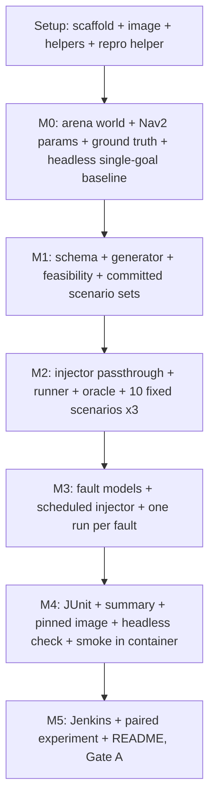

# Implementation Plan: Autonomy Test Harness

## Overview

This plan converts the design into incremental, code-focused tasks organized under milestones M0–M5. It is written to run **autonomously** with Kiro's "Run all tasks": every task is agent-implementable, and every milestone ends with an **automated verification gate** (a single repository command whose exit status decides pass or fail) instead of an owner review stop. The agent moves on when the gate exits 0. If a gate exits non-zero, the agent fixes the cause and re-runs it, up to 3 fix attempts for the same failure; after that it records the failure in `docs/BLOCKERS.md` (task, command, exit code, log path, suspected cause) and stops that task. Targets, thresholds, time limits, and tests are never loosened to make a gate pass.

**Earlier work:** an earlier run, made before the decisions in design.md existed, wrote the scaffold and the Scenario schema (`harness/schema/`). Every task is open again: each one brings its files in line with this plan and design.md, keeping whatever is already correct rather than starting over.

The harness is Python (pytest + Hypothesis) plus two ROS 2 nodes (the Fault_Injector and the Ground_Truth reader). The SUT is Nav2 with its minimal TurtleBot 4 simulation for Jazzy, launched through the stock `tb4_simulation_launch.py` and driven only through published interfaces; Nav2's code is never modified. Everything that touches ROS, Gazebo, or Nav2 runs inside the `ath-sim` Docker image. Every reported number comes from a repository script, recorded with its command, seed, and full 40-character commit hash; versions go in `docs/ENVIRONMENT.md` and licenses in `THIRD_PARTY.md`; no secrets are committed. By every milestone gate, each non-trivial Python module (more than one public function or more than 50 source lines) has unit tests that keep it at 80% statement coverage or more under `bash scripts/test_unit.sh`; a task that adds such a module and has no separate test task adds those tests itself. Commit after each task (`task <id>: <summary>`).

**Where this runs:** on the owner's Windows 11 desktop (design.md, "Execution environment"; `.kiro/steering/environment.md`). Shell scripts and Docker run in WSL `Ubuntu-24.04` through `scripts/wsl_run.sh`; Git runs on Windows; the Simulation, Nav2, and all Python code run in the `ath-sim` image with CPU rendering. Image builds, test runs in the image, suites, the experiment, and Jenkins builds never overlap: they all take `~/ath-shared/sim.lock`. Anything that may take longer than 10 minutes runs detached through `scripts/bg.sh` and is polled. The owner's only inputs (an empty private GitHub repository and the earlier files in place) are ready before the run starts.

## Milestone Dependency Graph



Every wave holds one task, so tasks run strictly in this order: no two tasks edit files, use Git, or run the simulator at the same time.

```json
{
  "waves": [
    { "id": 0, "tasks": ["0.1"] },
    { "id": 1, "tasks": ["0.2"] },
    { "id": 2, "tasks": ["0.3"] },
    { "id": 3, "tasks": ["0.4"] },
    { "id": 4, "tasks": ["1.1"] },
    { "id": 5, "tasks": ["1.2"] },
    { "id": 6, "tasks": ["1.3"] },
    { "id": 7, "tasks": ["1.4"] },
    { "id": 8, "tasks": ["1.5"] },
    { "id": 9, "tasks": ["1.6"] },
    { "id": 10, "tasks": ["2.1"] },
    { "id": 11, "tasks": ["2.2"] },
    { "id": 12, "tasks": ["2.3"] },
    { "id": 13, "tasks": ["2.4"] },
    { "id": 14, "tasks": ["2.5"] },
    { "id": 15, "tasks": ["2.6"] },
    { "id": 16, "tasks": ["2.7"] },
    { "id": 17, "tasks": ["2.8"] },
    { "id": 18, "tasks": ["3.1"] },
    { "id": 19, "tasks": ["3.2"] },
    { "id": 20, "tasks": ["3.3"] },
    { "id": 21, "tasks": ["3.4"] },
    { "id": 22, "tasks": ["3.5"] },
    { "id": 23, "tasks": ["3.6"] },
    { "id": 24, "tasks": ["3.7"] },
    { "id": 25, "tasks": ["3.8"] },
    { "id": 26, "tasks": ["3.9"] },
    { "id": 27, "tasks": ["4.1"] },
    { "id": 28, "tasks": ["4.2"] },
    { "id": 29, "tasks": ["4.3"] },
    { "id": 30, "tasks": ["4.4"] },
    { "id": 31, "tasks": ["4.5"] },
    { "id": 32, "tasks": ["4.6"] },
    { "id": 33, "tasks": ["4.7"] },
    { "id": 34, "tasks": ["5.1"] },
    { "id": 35, "tasks": ["5.2"] },
    { "id": 36, "tasks": ["5.3"] },
    { "id": 37, "tasks": ["5.4"] },
    { "id": 38, "tasks": ["5.5"] },
    { "id": 39, "tasks": ["5.6"] },
    { "id": 40, "tasks": ["6.1"] },
    { "id": 41, "tasks": ["6.2"] },
    { "id": 42, "tasks": ["6.3"] },
    { "id": 43, "tasks": ["6.4"] },
    { "id": 44, "tasks": ["6.5"] },
    { "id": 45, "tasks": ["6.6"] },
    { "id": 46, "tasks": ["6.7"] },
    { "id": 47, "tasks": ["6.8"] }
  ]
}
```

## Tasks

## Setup (prerequisite scaffolding)

- [x] 0.1 Bring the repository scaffold, Python project, helper scripts, and GitHub remote in line with the design
  - Keep the earlier run's `harness/` (including `harness/schema/`), `config/`, `scenarios/`, `tests/fixtures/`, and `docs/ENVIRONMENT.md`. Create the remaining layout from design.md ("Repository layout"), including `harness/world/`, `worlds/`, `maps/`, `docker/`, `ci/jenkins/`, `scripts/`, `results/`, and `runs/` (gitignored).
  - Delete what the earlier run left that this plan replaces: an `.agents/` folder if one exists (another tool's notes from the earlier run; they do not apply to this plan) and the Unreal and Sensor Sim sections the earlier `.gitignore` copied from another project. Move `docs/THIRD_PARTY.md` to `THIRD_PARTY.md` at the repository root (the requirements' glossary names that path).
  - Make `pyproject.toml` a `uv` project with `requires-python = ">=3.12,<3.13"` (the image's Python is Ubuntu 24.04's 3.12) and one dependency set, every dependency pinned to an exact version: pydantic, numpy (`1.26.4`, the version Ubuntu 24.04's ROS packages use), PyYAML, hypothesis, pytest, pytest-cov. Register the pytest markers `ros` (needs `rclpy`, no simulator) and `sim` (needs the simulator). Generate `uv.lock` on the host with `wsl -d Ubuntu-24.04 -- bash /mnt/c/dev/Autonomy-Test-Harness/scripts/wsl_run.sh uv lock`.
  - Create `scripts/wsl_run.sh`, `scripts/bg.sh`, `scripts/bg_status.sh`, and `scripts/sim_lock.sh` exactly as written in `.kiro/steering/environment.md`.
  - Write `scripts/require_clean.sh`: it runs `git --no-optional-locks status --porcelain` and exits non-zero, listing the paths, if anything changed outside `results/`, `runs/`, `docs/`, `ci/jenkins_run_log/`, `README.md`, and `.kiro/`; otherwise it prints `git rev-parse HEAD`.
  - `.gitignore`: every secret-bearing pattern (`.env`, `*.env`, `*.pem`, `*.key`, `*.token`, `secrets.*`), `runs/`, `__pycache__/`, `.pytest_cache/`, `.hypothesis/`, `.coverage`, `htmlcov/`, `.venv/`, `*.mcap`, `*.db3`. `.gitattributes` and `.dockerignore` exactly as design.md specifies.
  - Make sure `docs/ENVIRONMENT.md` and `THIRD_PARTY.md` exist with section headers and that `README.md` states the repository is private.
  - From PowerShell: if the folder is not a Git repository, run `git init -b main`; otherwise keep its current branch. Set `origin` to `https://github.com/OctaviusLeo/Autonomy-Test-Harness.git` (the owner made it private and it is empty), commit, and `git push -u origin HEAD`.
  - _Requirements: 0.5, 0.7, 0.8, 11.1_

- [x] 0.2 Build the `ath-sim` image and the image-based test command
  - Write `scripts/resolve_apt_pins.sh`: it resolves the current digest of `ros:jazzy-ros-base-noble`, then runs `apt-cache policy` inside that pinned image for each package design.md lists ("Docker image and headless rendering") and writes `docker/apt-pins.txt` (one `name=version` per line) and `docker/base-image.txt` (the digest).
  - Write `docker/Dockerfile`, `docker/entrypoint.sh`, and `.dockerignore` as design.md describes: digest-pinned base, exact apt versions from `docker/apt-pins.txt`, `uv` copied from `ghcr.io/astral-sh/uv:<the host's uv version>`, `/opt/venv` with system site packages and `uv sync --frozen`, the harness installed editable at `/opt/ath`, `git config --system --add safe.directory '*'`, and the entrypoint that sources ROS and applies `ATH_RENDER_MODE` (default `egl`).
  - Write `scripts/build_image.sh [--tag <tag>]`: under the simulation lock, it builds `ath-sim:dev` by default; with `--tag ath-sim:<commit>` it first runs `scripts/require_clean.sh` and refuses if the tree is dirty. It records the built image's ID and size in its log.
  - Write `scripts/test_unit.sh [--image <tag>] [--baked] [--junit <path>]`: under the simulation lock, it runs `pytest -m "not sim"` inside the image (default `ath-sim:dev` with the working tree mounted at `/opt/ath`; with `--baked`, the code built into the image), with coverage over `harness/` and `scripts/` written to `runs/coverage.json`, then `python scripts/check_coverage.py runs/coverage.json`. Write `scripts/check_coverage.py`, with its own unit tests, which fails and lists every module in `harness/` or `scripts/` that has more than one public function or more than 50 source lines and is under 80% statement coverage.
  - Add unit tests for the earlier run's `harness/schema/` now (the committed valid example loads; each invalid fixture is rejected with an error naming the field or version), so every existing module meets the coverage rule from the start; task 2.2 extends them.
  - Start the first build detached (`bash scripts/bg.sh build_dev bash scripts/build_image.sh`) and poll it. Then confirm `bash scripts/test_unit.sh` exits 0.
  - _Requirements: 8.1, 8.4, 0.9, 1.1_

- [x] 0.3 Implement the shared reproducibility helper
  - `harness/repro.py` provides `commit_hash()` (`ATH_COMMIT` when set, otherwise `git rev-parse HEAD`, always a full 40-character hash), a `Stamp` dataclass `{command, seed, commit}`, and `stamp_json(obj, stamp)`, used by every result-writing script. Host scripts that start a reported run call `scripts/require_clean.sh` first and pass its hash into the container as `ATH_COMMIT`.
  - _Requirements: 0.1, 0.2_

- [x] 0.4 Write unit tests for the reproducibility helper
  - Assert the commit hash is 40 hex characters, that `ATH_COMMIT` takes precedence, that a malformed `ATH_COMMIT` is rejected, and that a stamp round-trips through JSON. Test `scripts/require_clean.sh` in a throwaway repository in a temporary directory (a change under `results/` is allowed; a change under `harness/` is refused).
  - _Requirements: 0.1_

## M0 — Arena, ground truth, and the headless single-goal baseline

- [x] 1.1 Build the arena world and its map
  - `harness/world/arena.py` defines the `empty_10x10` arena exactly as design.md describes ("World and map") and writes the world SDF (with the stock world's systems plus `SceneBroadcaster`, and the `xacro` `headless` argument) and the map PGM/YAML whose origin makes map coordinates equal world coordinates. It also exposes the walls as shapes for the Generator and the Oracle.
  - Write `scripts/build_world.py`, which writes `worlds/empty_10x10.sdf` and `maps/empty_10x10.{pgm,yaml}`; commit the outputs.
  - Unit tests: wall cells in the map match the wall shapes; the interior is free; a map cell's center converts to the same world coordinate the arena uses; the SDF parses and names the world `empty_10x10`; regenerating gives identical bytes.
  - _Requirements: 2.6, 3.6_

- [x] 1.2 Generate the Nav2 parameter file
  - `scripts/make_nav2_params.py` (logic in `harness/nav2_params.py`) runs inside the image, reads the installed stock `nav2_params.yaml` from `nav2_bringup`'s share directory, and writes `config/nav2_params_ath.yaml` with exactly the four lidar topics design.md names changed to `/scan_ath`. It also saves a copy of the stock file as `docs/evidence/nav2_params_stock.yaml` for the diff.
  - Unit test: load both files and assert the only differences are those four values.
  - _Requirements: 0.10, 4.1_

- [x] 1.3 Implement the Ground_Truth reader and the process helpers
  - `harness/runner/gt_bridge.py` is the ROS 2 node design.md describes: it runs `gz topic -e -t /world/<world>/dynamic_pose/info --json-output`, parses each line (64-bit integers as strings, missing fields as zero), and publishes `geometry_msgs/PoseStamped` on `/ath/ground_truth/robot_pose` for the model `nav2_turtlebot4`, stamped with simulation time, frame `map`.
  - `harness/runner/processes.py` starts a command in its own process group with a log file, stops a group (SIGINT, then SIGKILL after 10 s), and lists leftover processes by the names design.md gives; the process layer is injectable so tests use fakes.
  - Tests (`ros` marker where `rclpy` is needed): a recorded or synthetic JSON stream produces the expected poses and stamps; lines for other models are ignored; a malformed line is skipped and counted; the process helper kills a sleeping child group and reports leftovers.
  - _Requirements: 6.1, 5.2, 5.5_

- [x] 1.4 Write the M0 baseline script
  - `scripts/m0_baseline.py` (logic in `harness/m0.py`, tested with fakes) runs inside the image and does the following, writing logs to `/results/m0/`:
    - records `dpkg-query -W` for `ros-jazzy-navigation2`, `ros-jazzy-nav2-bringup`, and every installed `ros-jazzy-nav2-minimal-tb*` package, plus `/etc/os-release`, `gz sim --versions`, and the ROS distro;
    - launches `tb4_simulation_launch.py` with `headless:=True use_rviz:=False`, the arena world and map, the **stock** parameter file, and start pose (−3.0, −3.0, 0.0), first in EGL mode;
    - decides the rendering method by design.md's rule: EGL passes if `ogre2.log` shows a renderer and `/scan` has at least 300 finite ranges per message; otherwise it relaunches with `ATH_RENDER_MODE=xvfb` and checks again; it records the method and the renderer string;
    - sets the initial pose, waits for Nav2 to become active, sends one goal (3.0, 3.0, 1.57) through `NavigateToPose`, and waits up to 120 s of simulation time;
    - reads the true final pose from the Ground_Truth reader and computes the position and yaw error to the goal;
    - records the `base_link` to `rplidar_link` yaw from TF;
    - writes `results/m0_baseline.json` stamped with command, seed (0), and commit: package versions, render method, launch-log path, action result, true-pose-to-goal distance and yaw error, and the tolerance used (0.30 m, the Oracle's).
  - On any failing step (`image`, `render`, `launch`, `nav2_activate`, `goal`, `ground_truth`) it records the step and the observed effect and exits non-zero.
  - Write `scripts/run_m0.sh`, which runs it under the simulation lock in a container from `ath-sim:<commit>` (with design.md's container options: `--shm-size=1g`, no GPU, no display, output handed back to the calling user), with `~/ath-shared/runs/m0-<timestamp>/` mounted at `/results`, and copies the JSON and the logs it names into `results/` and `docs/evidence/`.
  - _Requirements: 1.2, 1.3, 1.4, 0.1, 0.10_

- [x] 1.5 Run the M0 baseline and record the environment
  - Commit, build `ath-sim:<commit>`, then run `scripts/run_m0.sh` detached and poll it.
  - Record in `docs/ENVIRONMENT.md`, each beside its evidence file under `docs/evidence/`: the OS, ROS 2 Jazzy, Gazebo, each Nav2 and minimal-simulation package version, the base image digest, the host's Docker version (`docker version`), uv, Python, and the Python packages from `uv.lock`. Record the rendering method and renderer string in a "Headless rendering" section.
  - Fill the "M0 outcome" block in design.md and in `docs/ENVIRONMENT.md`. Set the image's default `ATH_RENDER_MODE` to the chosen method.
  - Record in `THIRD_PARTY.md` the base image, Nav2, the minimal TurtleBot simulation, Gazebo (`ros_gz`), and each Python package, with versions and license identifiers.
  - If any step fails, record the failing step and its observed effect in `docs/ENVIRONMENT.md`; the M0 gate then fails and later milestones do not run.
  - _Requirements: 1.1, 1.2, 1.3, 1.4, 1.5, 0.5, 0.6, 0.7, 8.2_

- [x] 1.6 **Automated gate (M0):** run `bash scripts/verify_m0.sh`, which runs `bash scripts/test_unit.sh` and checks:
  - `results/m0_baseline.json` shows action result `SUCCEEDED`, a true-pose-to-goal distance at most 0.30 m, a render method, and a stamp with a 40-character commit hash;
  - `docs/ENVIRONMENT.md` has no `TBD` in its versions table or M0 sections, and every evidence path it cites exists;
  - design.md's "M0 outcome" block has no `TBD`;
  - regenerating the world, map, and Nav2 parameter file into `runs/` gives files identical to the committed ones;
  - `.gitignore`, `.gitattributes`, and `.dockerignore` hold the design's entries.
  - Proceed when it exits 0. No manual review stop.

## M1 — Scenario schema and generator

- [x] 2.1 Bring the Scenario schema in line with the design
  - Keep the earlier run's pydantic v2 models in `harness/schema/scenario.py` and `load_scenario` in `validate.py`. Restrict `world` to the supported set (`empty_10x10`), require `center_deg` in [0, 360), remove the `odom_drift` Fault type (not implemented; design.md records why), and document that Fault windows are seconds after goal dispatch. All poses are in the map frame, documented in the module.
  - Add `dump_scenario(scenario) -> str`, deterministic YAML (fixed key order, floats rounded to 4 decimals), and make `load_scenario` report every error with the offending field path or the unsupported version.
  - _Requirements: 2.1, 2.2, 2.3, 2.4, 2.5, 2.6_

- [x] 2.2 Write property and unit tests for schema validation
  - **Property 4: Schema validation enforces bounds and version** — drive each field out of bounds, give it the wrong type, leave it missing, or use an unsupported version or world; the loader rejects it and the error names the field or version.
  - Unit tests: the example in design.md loads; `dump_scenario` then `load_scenario` round-trips; `odom_drift` is rejected naming `type`.
  - **Validates: Requirements 2.3, 2.4**

- [x] 2.3 Implement the generator and the feasibility check
  - `harness/generator/generate.py` implements `generate(seed, n, config)` and `generate_one(scenario_seed, config, scenario_id)` exactly as design.md's "Generator algorithm" describes: per-Scenario seeds drawn from the set RNG, obstacle and pose sampling, the start-to-goal distance rule, replacement of rejected draws, and rejection counts by reason.
  - `harness/generator/feasibility.py` implements `is_feasible`: the occupancy grid from the arena's walls and the obstacles, inflated by `robot_radius_m + clearance_m`, and the three rejection reasons (`start_inside_obstacle`, `off_map`, `unreachable` by 4-connected BFS).
  - Write `config/generator.yaml` and `config/generator_smoke.yaml` with the values in design.md's GeneratorConfig table, validated on load.
  - _Requirements: 3.1, 3.3, 3.4, 3.5, 3.6, 0.2_

- [x] 2.4 Write property tests for generator feasibility
  - **Property 2: Generator returns exactly N feasible scenarios** — every returned Scenario has its start free, start and goal on the map, and the goal in the start's free component.
  - **Property 3: Infeasible scenarios are rejected by reason** — constructed start-in-obstacle, off-map, and disconnected-goal cases are rejected with the matching reason.
  - **Validates: Requirements 3.1, 3.3, 3.4, 3.6**

- [x] 2.5 Implement the scenario-set CLI and the regenerate command
  - `python -m harness.generator.cli generate --config <yaml> --out <dir> --prefix <id prefix>` writes one YAML file per Scenario plus a stamped `generation.json` (command, set seed, commit, N, rejection counts by reason).
  - `python -m harness.generator.cli regenerate --config <yaml> --seed <scenario seed> --id <scenario id>` writes that one Scenario; it is the generation half of `scripts/rerun_one.sh` (task 3.5).
  - _Requirements: 3.2, 3.4, 3.5, 5.6_

- [x] 2.6 Write property tests for determinism and regeneration
  - **Property 1: Generator determinism under fixed seed** — two runs with the same seed and config give byte-identical YAML.
  - **Property 19: Scenario re-run from seed reproduces the scenario** — `generate_one` on a Scenario's stored seed gives an equal Scenario.
  - **Validates: Requirements 3.2, 3.5, 5.6, 0.3**

- [x] 2.7 Generate and commit the scenario sets
  - Commit, then generate `scenarios/fixed10/` from `config/generator_smoke.yaml` (prefix `fixed10`) and `scenarios/experiment30/` from `config/generator.yaml` (prefix `exp30`) inside the image, and commit both with their `generation.json`.
  - _Requirements: 3.1, 3.2, 3.4, 0.1_

- [x] 2.8 **Automated gate (M1):** run `bash scripts/verify_m1.sh`, which runs `bash scripts/test_unit.sh` and checks:
  - regenerating both sets into `runs/` gives byte-identical files;
  - each set has the right count, every file loads with `load_scenario`, and `generation.json` holds rejection counts by reason and a stamp;
  - regenerating the first Scenario of each set from its stored seed gives an identical file.
  - Proceed when it exits 0. No manual review stop.

## M2 — Runner and oracle (10 fixed scenarios, no faults)

- [x] 3.1 Implement the injector node with passthrough and scheduling hooks
  - `harness/faults/schedule.py` (pure) decides which Faults are active at t seconds after dispatch (`start_s ≤ t < end_s`).
  - `harness/faults/injector_node.py` subscribes to `/scan` and publishes `/scan_ath`, passing every scan through unchanged until `/ath/goal_dispatch` arrives and whenever no Fault is active; it publishes the active Fault types on `/ath/faults/active`. Task 4.3 adds the fault models.
  - Tests (`ros` marker for the node): with no Faults, every output equals its input; the schedule's boundaries behave as stated.
  - _Requirements: 4.1, 4.2_

- [x] 3.2 Implement the Oracle
  - `harness/oracle/geometry.py`: distance from a point to an oriented rectangle and to a circle, and clearance (distance minus `footprint_radius_m`).
  - `harness/oracle/judge.py`: `judge(...)` exactly as design.md's "Oracle design" describes, from Ground_Truth samples only, returning a `Verdict` with `passed`, `reason` (`"collision"` before `"timeout"`), `detail`, `time_to_goal_s`, and `min_clearance_m`, with walls included.
  - `harness/oracle/bag_reader.py`: reads `/ath/ground_truth/robot_pose` and `/ath/goal_dispatch` from an MCAP bag with `rosbag2_py`.
  - Write `config/run.yaml` with design.md's RunConfig values.
  - _Requirements: 6.1, 6.2, 6.3, 6.4, 6.5, 6.6_

- [x] 3.3 Write property and unit tests for the Oracle
  - **Property 11: Oracle collision decision**, **Property 12: Oracle goal-and-timeout decision**, and **Property 13: Oracle ignores the robot's own estimate** — one Hypothesis test each.
  - Unit tests with known answers: clearance exactly at the threshold, goal reached exactly at each tolerance, goal reached exactly at the time limit, a wall collision, and a run where Nav2 reports `SUCCEEDED` but the true pose is outside tolerance (fails with reason `"timeout"`, detail shows `SUCCEEDED`). A `ros`-marked test reads a small bag written in the test.
  - **Validates: Requirements 6.1, 6.2, 6.3, 6.4, 6.5, 6.7**

- [x] 3.4 Implement the per-Scenario lifecycle
  - `harness/runner/run_scenario.py` implements `run_scenario` exactly as design.md's "Runner design" steps 1–9 describe: isolation variables, the stock launch with the arena world and map and `config/nav2_params_ath.yaml`, readiness check, obstacle spawning with `ros_gz_sim create`, the Ground_Truth reader, the injector, `ros2 bag record --use-sim-time` (MCAP, `zstd_fast`) named by `scenario_id`, initial pose, goal, dispatch-time publication, the simulation-time limit, teardown with the leftover-process check, and the Oracle call. It writes `run_record.json` and `verdict.json`, and marks failures `errored` with the failing step (`launch`, `spawn`, `nav2_activate`, `goal`, `ground_truth`).
  - _Requirements: 5.1, 5.2, 5.4, 5.5, 5.7, 0.10_

- [x] 3.5 Implement the suite runner and the host scripts
  - `harness/runner/suite.py` runs each Scenario in a child process with the hard wall-clock limit from design.md, marks a killed run `timed_out` (Verdict fail, reason `"timeout"`), runs the teardown check, and continues; it writes all RunRecords plus a stamped `suite.json`.
  - Write `scripts/run_suite.sh <smoke|full|<scenario dir>> [--image <tag>] [--out <dir>] [--repeat <n>]`: under the simulation lock, it runs the suite in one container with design.md's container options and `--out` (default `~/ath-shared/runs/<run_id>/`) mounted at `/results`, passing `ATH_COMMIT` (from the environment when Jenkins sets it, otherwise from `scripts/require_clean.sh`). `smoke` is `scenarios/fixed10` (or the selection recorded in design.md if task 3.8 had to apply the stability rule); `full` is `fixed10` plus `experiment30`.
  - Write `scripts/rerun_one.sh --config <generator yaml> --seed <seed> [--condition <name>]`: it regenerates the Scenario, checks it equals the committed file with that seed, and runs it alone.
  - _Requirements: 5.3, 5.6, 5.7_

- [x] 3.6 Write unit tests for the Runner
  - With fake processes and a fake clock: a hung Scenario is killed at the hard limit, marked `timed_out`, and the suite continues; a spawn failure is `errored` with step `spawn` and the next Scenario still runs; leftover processes are detected, killed, and recorded; the bag path is derived from `scenario_id`; the RunRecord carries the stamp.
  - _Requirements: 5.2, 5.3, 5.4, 5.7_

- [x] 3.7 Run one Scenario end to end and check the wiring
  - Commit, build `ath-sim:<commit>`, and run the first `fixed10` Scenario with `scripts/run_suite.sh` (a one-Scenario directory under `runs/`). From its bag and logs confirm: Nav2's AMCL, costmaps, and collision monitor subscribe to `/scan_ath` (save `ros2 topic info /scan_ath -v` captured during the run); `/scan_ath` equals `/scan` (no Faults); Ground_Truth samples exist; teardown left no process. Fix the Runner within the retry cap if any check fails. Save the evidence under `docs/evidence/m2_wiring/`.
  - _Requirements: 5.1, 5.2, 5.5, 4.1_

- [x] 3.8 Run the 10 fixed no-Fault Scenarios three times
  - Commit, build `ath-sim:<commit>`, then run `bash scripts/run_suite.sh smoke --repeat 3` detached and poll it.
  - Copy the RunRecords, Verdicts, and a stamped `results/m2_fixed10/summary.json` (per repeat: passes, failures with reasons, errored, timed out; per Scenario: whether the outcome changed between repeats) into `results/m2_fixed10/`. Report the real results; never loosen a threshold or time limit.
  - If a Scenario errored or was timed out by the hard limit, treat it as a harness defect and fix it within the retry cap. If a Scenario failed its Verdict because of Nav2's behavior (the bag shows Nav2 driving as commanded), keep the result and apply design.md's Smoke_Suite stability rule: record the selected ids, the excluded ids, and the reason in design.md ("CI design").
  - _Requirements: 5.1, 5.5, 6.4, 0.1, 0.4_

- [x] 3.9 **Automated gate (M2):** run `bash scripts/verify_m2.sh`, which runs `bash scripts/test_unit.sh` and checks:
  - `results/m2_fixed10/` holds 30 RunRecords (10 Scenarios × 3 repeats), each with a Verdict and a stamp, none `errored` or `timed_out`, and none with unresolved leftover processes;
  - every RunRecord's bag exists under `~/ath-shared/runs/`;
  - the Smoke_Suite (all of `fixed10`, or the recorded selection of at least 8) passed in all three repeats;
  - `docs/evidence/m2_wiring/` shows Nav2 subscribed to `/scan_ath`.
  - Proceed when it exits 0. No manual review stop.

## M3 — Fault injection

- [x] 4.1 Implement the fault models
  - `harness/faults/models.py` implements the six pure fault functions exactly as design.md's "Fault models" describes (bearing in the scan's own frame in [0, 360), no-return as `+inf`, range-noise clipping, the latency queue checked at 200 Hz of simulation time, freeze state, circular sector test), each with an RNG seeded from `[scenario.seed, fault_index]`.
  - _Requirements: 4.3, 4.4, 4.5, 4.6, 4.7, 4.8, 4.9, 0.2, 0.3_

- [x] 4.2 Write property and unit tests for the fault models
  - **Property 6: Range-noise standard deviation is recovered** (at least 1,000 returns away from the range limits, ±10%).
  - **Property 7: Dropout fraction matches configured probability** (at least 1,000 rays, ±2 percentage points).
  - **Property 8: Latency delay matches configuration** (at least 100 messages, ±20%, never released early).
  - **Property 9: Frozen scan repeats the last pre-window scan**.
  - **Property 10: Sector blackout affects exactly the configured sector** (including sectors that wrap past 0°).
  - Plus one unit test per Fault type, including whole-scan dropout publishing nothing in its window, showing the output matches the configured effect.
  - **Validates: Requirements 4.4, 4.5, 4.6, 4.7, 4.8, 4.9, 4.11**

- [x] 4.3 Apply the scheduled faults in the injector node
  - Extend `injector_node.py` to apply each active Fault from the Scenario with its own seeded RNG, in Scenario order, from the dispatch time on; outside every window the scan passes through unchanged. Whole-scan dropout publishes nothing; latency releases from the queue on a 200 Hz simulation-time timer; freeze republishes the stored pre-window scan.
  - _Requirements: 4.1, 4.2, 4.3_

- [x] 4.4 Write property and node tests for fault windowing
  - **Property 5: Faults apply only inside their window** — for scan times outside every window the output equals the input; inside, it reflects the Fault (tested on `schedule.py` plus the pure apply path).
  - A `ros`-marked test publishes a synthetic scan stream and a dispatch time to the node and checks the republished stream inside and outside one window per Fault type.
  - **Validates: Requirements 4.2, 4.11**

- [x] 4.5 Record the odometry-drift decision and write the fault conditions
  - Confirm design.md's "Fault models" records that odometry drift is not implemented and why, and that the schema rejects it.
  - Write `config/faults.yaml` (defaults and bounds per type) and `config/experiment.yaml` (the seven conditions in design.md, with the sector center taken from the lidar mount yaw recorded at M0: forward = 360° − mount yaw in degrees, expected 270°).
  - Write `harness/experiment/conditions.py` with `apply_condition(scenario, condition) -> Scenario` (adds the condition's one Fault; `none` returns the Scenario unchanged) and a CLI that writes one file per condition for a base Scenario, with unit tests. Task 4.6 and the experiment use it.
  - _Requirements: 4.10, 4.3, 10.1_

- [x] 4.6 Run one Scenario per Fault type end to end
  - Commit, build `ath-sim:<commit>`, write the six Fault-condition variants of the first `experiment30` Scenario into `runs/m3_conditions/` with the conditions CLI, and run that directory with `scripts/run_suite.sh`, detached.
  - From each bag compute, for every scan pair, whether `/scan_ath` differs from `/scan`, and confirm differences occur only inside the Fault's window (scan dropout: no `/scan_ath` messages inside it; latency: measured delay within ±20% of the setting). Write a stamped `results/m3_fault_check.json` with one entry per Fault type and each run's Verdict.
  - _Requirements: 4.1, 4.2, 4.6, 4.7, 0.1_

- [x] 4.7 **Automated gate (M3):** run `bash scripts/verify_m3.sh`, which runs `bash scripts/test_unit.sh` and checks:
  - `results/m3_fault_check.json` has all six Fault types, each confined to its window, with a Verdict and a stamp;
  - design.md records the odometry-drift decision and the schema rejects `odom_drift`;
  - `config/experiment.yaml` has the seven conditions with values inside the schema's bounds.
  - Proceed when it exits 0. No manual review stop.

## M4 — Reports and Docker

- [x] 5.1 Implement the JUnit and summary writers
  - `harness/reporting/junit.py` (`write_junit`) and `harness/reporting/summary.py` (`write_summary`) exactly as design.md's "Reports" section describes: one test case per Scenario, failures carrying reason and detail, errored cases as errors, pass rate per Fault type, a bag link and the exact `scripts/rerun_one.sh` command with seed for every failure, the stamp, write-to-temporary-then-rename, and a clear error naming any missing or unparsable input.
  - Wire both into `suite.py` so every suite writes `junit.xml` and `summary.md`.
  - _Requirements: 7.1, 7.2, 7.3, 7.4, 7.5_

- [x] 5.2 Write property tests for the reports
  - **Property 14: JUnit report has one case per scenario**, **Property 15: Summary links a bag and a re-run command for every failure**, and **Property 16: Missing or unparsable report input is rejected** — one Hypothesis test each; the JUnit test also parses the output with a standard XML parser.
  - **Validates: Requirements 7.1, 7.2, 7.3, 7.5**

- [x] 5.3 Check the image's pins and document them
  - Write `scripts/check_dockerfile_pins.py` (with unit tests): it fails if the base image is not pinned by digest or if any `apt-get install` in the Dockerfile installs a package without an exact version from `docker/apt-pins.txt`, and it confirms the Python dependencies come only from `uv.lock`.
  - Record in `docs/ENVIRONMENT.md` the base image digest, every line of `docker/apt-pins.txt`, and the reproducibility limit from design.md.
  - _Requirements: 8.1, 8.4, 0.5, 0.6_

- [x] 5.4 Write and run the headless-render check
  - `scripts/check_headless_render.sh` (logic in `harness/render_check.py`) does what design.md describes: in the container with no display attached, it starts the arena world with one 1.0 m box 2.0 m in front of the lidar, reads one `/scan`, checks the beam toward the box measures the expected range within 0.05 m and that at least 300 ranges are finite, and records the command and output in `results/headless_render_check.txt`.
  - Commit, build `ath-sim:<commit>`, run it, and fill design.md's "Headless-rendering outcome" block and the "Headless rendering" section of `docs/ENVIRONMENT.md`.
  - _Requirements: 8.2, 8.3_

- [x] 5.5 Run the Smoke_Suite in the container with reports
  - Commit, build `ath-sim:<commit>`, then run `env -u DISPLAY -u WAYLAND_DISPLAY bash scripts/run_suite.sh smoke` detached (WSLg sets those variables; the container also gets no X socket mount), and copy `junit.xml`, `summary.md`, and `suite.json` into `results/smoke/`.
  - _Requirements: 8.5, 7.1, 7.2, 9.1_

- [x] 5.6 **Automated gate (M4):** run `bash scripts/verify_m4.sh`, which runs `bash scripts/test_unit.sh` and `python scripts/check_dockerfile_pins.py` (in the image), and checks:
  - `results/headless_render_check.txt` shows a pass, with its command;
  - design.md's "Headless-rendering outcome" block has no `TBD`;
  - `results/smoke/junit.xml` parses and has one test case per Smoke_Suite Scenario, all passing; `results/smoke/summary.md` exists with a stamp.
  - Proceed when it exits 0. No manual review stop.

## M5 — Jenkins, paired experiment, README (Gate A)

- [x] 6.1 Write the Jenkins pipeline
  - Write `ci/Jenkinsfile` exactly as design.md's "Pipeline" describes: build `ath-sim:${GIT_COMMIT}`; unit tests with `scripts/test_unit.sh --image ath-sim:${GIT_COMMIT} --baked` and their JUnit file published; `smoke` for change builds or `full` when `currentBuild.getBuildCauses('hudson.triggers.TimerTrigger$TimerTriggerCause')` is not empty, through `scripts/run_suite.sh` with output under `${ATH_SHARED}/jenkins/${BUILD_TAG}/`; publish the scenario JUnit report and the summary; archive failed runs' bags; `disableConcurrentBuilds()` and a 24-hour timeout. The build fails if any unit test fails, any Scenario errors, or any Smoke_Suite Scenario fails its Verdict. Commit it before the controller starts (task 6.2), so Jenkins's first poll builds a commit that has `ci/Jenkinsfile`.
  - _Requirements: 9.1, 9.2, 9.3, 9.4_

- [x] 6.2 Set up the Jenkins controller
  - Write `ci/jenkins/Dockerfile`, `ci/jenkins/plugins.txt`, `ci/jenkins/casc.yaml`, and `ci/jenkins/docker-compose.yml` exactly as design.md's "CI design" describes (base `jenkins/jenkins:2.580.1-lts-jdk21` pinned by digest, plugins at exact versions, Docker CLI and Buildx from `docker:29.9.1-cli`, Configuration as Code with the admin password from the environment, anonymous read, one executor, the Job DSL `pipelineJob('autonomy-test-harness')` from `file:///repo` branch `main` with `pollSCM('H/5 * * * *')`, `cron('H 2 * * *')`, and the path restriction; Compose project `ath-jenkins` on `127.0.0.1:8091`, the Docker socket with its group, the repository read-only at `/repo`, and `~/ath-shared` at the same absolute path).
  - Write `scripts/jenkins_up.sh`: it creates `~/.config/ath/jenkins.env` (mode 600, a random 32-character `ATH_JENKINS_ADMIN_PASSWORD`) if missing, never printing it; reads the Docker socket's group id; runs `docker compose -p ath-jenkins -f ci/jenkins/docker-compose.yml up -d --build`; and waits for `http://127.0.0.1:8091/login` to return 200.
  - Write `scripts/jenkins_wait_build.sh <commit>`: polls `http://127.0.0.1:8091/job/autonomy-test-harness/api/json` (anonymous read) until a finished build exists whose built revision is that commit, and prints its number and result.
  - Commit, then run `scripts/jenkins_up.sh` detached and poll it; confirm the job exists and `docker version` works inside `ath-jenkins`. Record Jenkins, its plugins, and the Docker CLI with versions and licenses in `docs/ENVIRONMENT.md` and `THIRD_PARTY.md`.
  - _Requirements: 9.1, 9.2, 0.5, 0.7, 0.8_

- [ ] 6.3 Verify the pipeline and commit the evidence
  - Commit and push. Run `scripts/jenkins_wait_build.sh <HEAD>` detached until the build for HEAD finishes; it must be `SUCCESS` with the scenario test cases shown in its test report.
  - Commit one intentionally failing unit test (`tests/test_ci_red_check.py`), wait for its build, and confirm it is `FAILURE` because of that test. Then commit a revert of that change (a new commit; never rewrite history) and wait for its build to be `SUCCESS`.
  - Save, under `ci/jenkins_run_log/`: the console log of the last green build (`/job/autonomy-test-harness/<n>/consoleText`), its JSON summary, `verification.json` (build numbers, commits, and results for the green, red, and revert builds), and the job's trigger configuration read with the admin credentials from `config.xml` (showing the poll and nightly timer specs). Commit them (the path restriction keeps this commit from starting a build).
  - _Requirements: 9.2, 9.3, 9.4, 9.5_

- [ ] 6.4 Implement the paired experiment and its statistics
  - `harness/experiment/stats.py`: `wilson_interval(passes, n, z=1.959964)` with design.md's formula.
  - `harness/experiment/paired.py`: `run_paired` builds each condition's Scenarios from the 30 base Scenarios and `config/experiment.yaml` (base plus one Fault), runs conditions in design.md's order through the suite runner, retries an errored run once and records both attempts, keeps completed runs when restarted on the same output directory and skips them, and writes a stamped `experiment.json` (per condition: n, passes, pass rate, Wilson interval, errored after retry; total run time and segments), per-condition JUnit files, and the generated `summary.md`.
  - Write `scripts/run_experiment.sh`: under the simulation lock, it runs the experiment in one container from `ath-sim:<commit>` with output under `~/ath-shared/runs/experiment-<commit>/`, then copies the JSON, JUnit files, and summary into `results/experiment/` and the summary to `results/summary.md`.
  - _Requirements: 10.1, 10.2, 10.3, 10.4_

- [ ] 6.5 Write property and unit tests for the experiment
  - **Property 17: Paired experiment uses identical scenarios across conditions** and **Property 18: Confidence interval is a valid 95% interval** — one Hypothesis test each.
  - Unit tests: `wilson_interval(27, 30)` is [0.744, 0.965] and `wilson_interval(15, 30)` is [0.332, 0.668] within 1e-3; resumption skips completed runs and keeps the total run time as the sum of run durations; an errored run is retried once.
  - **Validates: Requirements 10.1, 10.2, 10.3**

- [ ] 6.6 Run the paired experiment
  - Commit, build `ath-sim:<commit>`, then run `bash scripts/bg.sh experiment bash scripts/run_experiment.sh` and poll it (210 runs; this is the longest job in the plan). If the job is `LOST`, start it again with the same command once; it resumes. Report the real rates even when a Fault lowers them; never change a threshold, time limit, or Fault setting to alter an outcome.
  - _Requirements: 10.1, 10.2, 10.3, 10.4, 10.5, 0.1, 0.4_

- [ ] 6.7 Generate the README
  - Write `docs/README.template.md` and `scripts/build_docs.py`, which fills every number from `results/` and generates `README.md` with: the architecture diagram, the Scenario format, how to run locally (`bash scripts/test_unit.sh`, `bash scripts/run_suite.sh smoke`, `bash scripts/run_experiment.sh`) and in Jenkins (`bash scripts/jenkins_up.sh`, the job, the triggers), the exact unit-test and Smoke_Suite commands matching the pipeline, the Paired_Experiment table (pass rate per condition with 95% Wilson intervals and the total run time) with its command, seed, and commit, the Smoke_Suite selection if one was recorded, the private-repository statement, and design.md's known limitations, stating that the faults are models rather than field data.
  - Write `scripts/check_traceability.py` (with unit tests): it fails if any number in `README.md` or `results/summary.md` (URLs and version strings excluded) does not appear in a generated file under `results/`. Run `scripts/build_docs.py`, then the check, which must pass.
  - _Requirements: 11.1, 11.2, 11.3, 9.6, 0.1, 0.9_

- [ ] 6.8 **Automated gate (end to end, Gate A):** run `bash scripts/verify_m5.sh`, which runs `bash scripts/test_unit.sh` and `scripts/check_traceability.py`, and checks:
  - `ci/jenkins_run_log/` holds a green build's console log showing the build, unit-test, and Smoke_Suite stages and `Finished: SUCCESS`, plus `verification.json` with the red build and the green revert, and the trigger configuration with both timers;
  - `results/experiment/experiment.json` has seven conditions with the same 30 Scenario ids each, every run with a Verdict (no errored run after retry), valid Wilson intervals, a total run time, and a stamp;
  - regenerating `results/summary.md` and `README.md` gives identical files;
  - `THIRD_PARTY.md` lists every package and image named in `docs/ENVIRONMENT.md`.
  - Then commit and push. The gate passes when all of this succeeds. The agent fixes failures and re-runs within the retry cap; it does not pause for input.
  - _Requirements: 11.4, 9.5, 10.4, 0.1, 0.4_

## Notes

- Tasks marked `*` are optional test sub-tasks and are not implemented by the task-execution agent. No task in this plan is marked `*`: every test task is required, because Requirement 0.9 and the design's one-test-per-property rule require them.
- The plan is fully agent-driven: there are no owner-implemented (`[ME]`) tasks and no manual review stops.
- The SUT (Nav2 and the minimal TurtleBot simulation) is never modified; the harness interacts with it only through topics, the `NavigateToPose` action, TF, and launch arguments, including the `params_file` argument whose only change is the four lidar topic names (Requirement 0.10).
- Image builds, test runs in the image, suites, the experiment, and Jenkins builds never run at the same time: all take `~/ath-shared/sim.lock`.
- Every reported number comes from a single repository command with a fixed seed, recorded with command, seed, and full commit hash; versions live in `docs/ENVIRONMENT.md`, licenses in `THIRD_PARTY.md`, and no secrets are committed.
