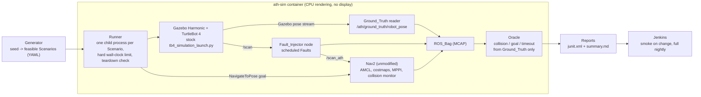

# Autonomy Test Harness

A scenario-based test system for robot navigation. It drives **Nav2** with its minimal TurtleBot 4
simulation (ROS 2 Jazzy, Gazebo Harmonic) through randomized, versioned scenarios, injects scheduled lidar
faults between the simulated sensor and Nav2, judges every run from simulator ground truth (never from the
robot's own estimate), and runs headless in Docker under a Jenkins pipeline.

**Why it matters.** A navigation stack that reports `SUCCEEDED` is not necessarily at the goal. Testing it
means controlled, repeatable stress (the same scenarios with and without each fault), a verdict that does
not trust the system under test, and enough runs to put an uncertainty on every pass rate.

## Headline result

A paired experiment: the same generated scenarios with no fault and under each lidar fault type, one run
per scenario and condition, with Nav2's pass rate and a 95% Wilson confidence interval.

{{EXPERIMENT_TABLE}}

- **Nav2 tolerates noisy, thinned or delayed scans** (range noise, ray dropout, latency), loses some runs
  under a forward sector blackout, and **fails every run when new scans stop arriving** (whole-scan dropout,
  frozen scans): AMCL stops publishing the `map` to `odom`
  transform, and the controller aborts with `Unable to transform goal pose into costmap frame` instead of
  continuing on odometry ([scan dropout log](docs/evidence/experiment/scan_dropout_abort_log.txt),
  [freeze log](docs/evidence/experiment/freeze_abort_log.txt)).
- **The ground-truth oracle catches false successes.** Under range noise and the forward sector blackout,
  several runs failed although Nav2 reported `SUCCEEDED`: the fault had pulled AMCL's estimate away from the
  true pose, so Nav2 stopped where it believed the goal was. A check based on the robot's own estimate would
  have passed those runs (failed-runs table in [results/summary.md](results/summary.md)).

This README is generated by `python scripts/build_docs.py` from `docs/README.template.md` and the files
under `results/`; every number in it comes from a generated results file, stamped with the command, seed and
commit that produced it ([details below](#experiment-details)).

## What I built

- **Scenario generator** (`harness/generator/`): draws obstacles, start and goal from a seed, rejects
  infeasible draws by reason, and writes versioned YAML scenarios that regenerate exactly from their seed.
- **Fault injector** (`harness/faults/`): a ROS 2 node between the simulated lidar and Nav2 with scheduled,
  seeded faults: range noise, ray dropout, whole-scan dropout, latency, freeze, and sector blackout.
- **Oracle** (`harness/oracle/`): judges collision, goal reached, and timeout from Gazebo's true poses only,
  reading the recorded ROS bag.
- **Runner** (`harness/runner/`, `scripts/robust.sh`): one child process per scenario with a hard
  wall-clock limit and a teardown check; a long step that crashes or stalls is retried with the next method
  on a ladder, while a real result (a failing test or verdict) is reported as it is.
- **Experiment and reporting** (`harness/experiment/`, `harness/reporting/`): paired conditions, Wilson
  intervals, resumable runs, JUnit XML with one test case per scenario, and a Markdown summary.
- **CI**: a Jenkins controller configured entirely as code (`ci/jenkins/`, `ci/Jenkinsfile`) that builds the
  image per commit, runs the unit and property tests, and runs the smoke suite on change and the full suite
  nightly. A GitHub Actions workflow runs the tests that need neither ROS 2 nor the simulator.

## Architecture



Nav2 reads the lidar through a parameter file identical to its stock `nav2_params.yaml` except the lidar
topic names, which point at the injector's `/scan_ath`; nothing else about Nav2 or the simulation changes.
Collisions are judged geometrically from true poses and shapes (the model has no contact sensor).

## Quickstart without ROS or Docker

The generator, schema, fault models, oracle geometry, statistics and reporting are plain Python, so their
tests run from a fresh clone with [uv](https://docs.astral.sh/uv/) (it installs the pinned Python and the
locked dependencies):

```bash
git clone https://github.com/OctaviusLeo/Autonomy-Test-Harness.git
cd Autonomy-Test-Harness
uv sync --frozen
uv run --frozen pytest -m "not sim and not ros"
```

Regenerate the committed smoke-suite scenarios from their seed and check they match byte for byte:

```bash
uv run --frozen python -m harness.generator.cli generate --config config/generator_smoke.yaml --out /tmp/fixed10 --prefix fixed10
diff -r -x generation.json scenarios/fixed10 /tmp/fixed10 && echo identical
```

Tests marked `ros` need `rclpy` and run in the `ath-sim` image; tests marked `sim` need the running simulator.

## Run the full harness

Everything that touches ROS, Gazebo, or Nav2 runs in the `ath-sim` image. It was developed on WSL 2 with
Docker Engine and needs no GPU and no display. Run shell scripts as `bash scripts/<name>.sh`.

```bash
bash scripts/build_image.sh                     # ath-sim:dev from the working tree
bash scripts/test_unit.sh                       # all unit and property tests in the image, with coverage
bash scripts/build_image.sh --tag ath-sim:$(git rev-parse HEAD)   # reported runs use a clean commit
bash scripts/run_suite.sh smoke                 # the Smoke_Suite (scenarios/fixed10)
bash scripts/run_suite.sh full                  # the Full_Suite (fixed10 + experiment30, no Faults)
bash scripts/run_experiment.sh                  # the Paired_Experiment (resumable)
bash scripts/rerun_one.sh --config config/generator.yaml --seed <seed> [--condition <name>]
```

## Scenario format

A Scenario is YAML (`scenarios/example_valid.yaml` is a complete example) with these fields:

| Field | Meaning |
| --- | --- |
| `schema_version` | Format version; an unsupported version is rejected by name |
| `scenario_id` | Name; the bag and the run records are stored under it |
| `seed` | This Scenario's own seed; regenerates it alone |
| `world` | Arena (`empty_10x10`, a walled square arena with a matching map) |
| `time_limit_s` | Simulation seconds after goal dispatch within which the goal must be reached |
| `start`, `goal` | `{x, y, yaw}` in the map frame (equal to the Gazebo world frame), meters and radians |
| `obstacles` | Each `{shape: box or cylinder, size, pose}`; spawned at run time and not on Nav2's map |
| `faults` | Each `{type, window: {start_s, end_s}, params}`; the window is simulation seconds after dispatch |

`harness/schema/scenario.py` defines the bounds; anything out of bounds, of the wrong type, missing, unknown,
or of an unsupported version or world is rejected with an error naming the field.

The Generator (`python -m harness.generator.cli generate --config <yaml> --out <dir> --prefix <id>`) draws
obstacles, start, and goal from a seed, rejects infeasible draws by reason (start inside an inflated
obstacle, off the map, or goal unreachable by a 4-connected flood fill on the inflated grid), and writes
each Scenario with its own seed so it can be regenerated and re-run alone.

## Continuous integration

`bash scripts/jenkins_up.sh` builds and starts a local controller (Compose project `ath-jenkins`) at
http://127.0.0.1:8091/ with anonymous read-only access; it is configured entirely from `ci/jenkins/`
(Configuration as Code, pinned plugins). The job `autonomy-test-harness` runs `ci/Jenkinsfile` from
`file:///repo` (this repository, mounted read-only): it polls for changes every few minutes and runs nightly.
Each build builds `ath-sim:<commit>`, runs the unit tests in it, then runs the Smoke_Suite (on a change) or
the Full_Suite (on the timer), publishes the JUnit reports (one test case per Scenario), and archives the
summary and the bags of failed runs. It fails if a unit test fails, a Scenario errors, or a Smoke_Suite
Scenario fails its Verdict.

The controller runs on the author's machine, so its builds do not show as GitHub checks. The evidence is
committed in [ci/jenkins_run_log/](ci/jenkins_run_log/): the console logs and JUnit test reports of a green
build, a deliberately red build (a failing unit test), and the green build after its revert, plus
`verification.json` and the job's trigger configuration.

These are the commands the pipeline runs (it adds `--image ath-sim:<commit> --baked` and output paths):

```bash
bash scripts/test_unit.sh
bash scripts/run_suite.sh smoke
```

On GitHub, [.github/workflows/tests.yml](.github/workflows/tests.yml) runs the tests that need neither ROS 2
nor the simulator on a hosted runner for every push and pull request.

## Repository layout

| Path | Contents |
| --- | --- |
| `harness/` | All logic: schema, generator, faults, runner, oracle, experiment, reporting, world |
| `scripts/` | Thin entry points (image build, suites, experiment, Jenkins helpers, gate checks) |
| `tests/` | Unit and property tests (pytest, Hypothesis) with fakes for processes, Docker, Gazebo and Nav2 |
| `scenarios/` | The committed scenario sets (`fixed10`, `experiment30`) and an example |
| `config/` | Generator, fault, experiment and run settings; the Nav2 parameter file |
| `docker/`, `ci/` | The `ath-sim` image, the Jenkins controller and pipeline, and the Jenkins run evidence |
| `results/` | Generated results (never edited by hand) |
| `docs/` | This README's template, versions with evidence (`docs/ENVIRONMENT.md`), and run evidence |
| `.kiro/specs/` | The requirements, design and task list the project was built from |

## Results

### Experiment details

{{EXPERIMENT_DETAILS}}

{{EXPERIMENT_STAMP}}

The commit hashes in the result stamps and in the Jenkins evidence come from the history before local IDE
files were removed from it; [docs/COMMIT_MAP.md](docs/COMMIT_MAP.md) maps each one to the commit in this
history with the same code.

### Smoke suite stability

{{M2_SUMMARY}}

### Fault injection check

{{M3_SUMMARY}}

### Platform baseline and headless rendering

{{M0_SUMMARY}}

{{RENDER_SUMMARY}}

## Known limitations

- **The injected faults are models, not field data.** They are simple, seeded lidar perturbations applied
  between the simulated sensor and Nav2; real sensor failures look different.
- **Software rendering.** Sensors render on the CPU with Mesa (`llvmpipe`); lidar geometry is exact, but timing
  differs from a GPU setup.
- **Not bit-for-bit repeatable.** Gazebo and Nav2 timing vary between runs of the same Scenario; the smoke
  suite's triple run reports how often outcomes changed.
- **No contact sensor.** The TurtleBot 4 model has none, so collisions are decided from true poses and shapes
  with a clearance threshold.
- **One arena, one robot, one parameter set.** Results describe Nav2's stock TurtleBot 4 configuration in one
  walled arena with obstacles that are not on the map.
- **One run per scenario and condition.** The intervals reflect the sample of scenarios, not run-to-run
  variation of the same scenario.
- **Image rebuilds age.** Pinned ROS package versions disappear from the ROS apt repository after its next
  sync; the image recorded for each run identifies what was tested.
- **Odometry drift is not implemented**: intercepting odometry and TF would change the simulation's wiring
  rather than use Nav2's published interfaces.

Versions with evidence are in [docs/ENVIRONMENT.md](docs/ENVIRONMENT.md). Code is released under the
[MIT License](LICENSE). Third-party packages and images are listed with their licenses in
[THIRD_PARTY.md](THIRD_PARTY.md); apart from a copy of Nav2's stock parameter file and the parameter file
derived from it (both Apache-2.0), none are redistributed here. There is no packaging or release.

## How this was built

This project was built with Claude Code (Anthropic's agentic coding tool) under a spec-driven workflow: written requirements, then a design, then a task list organized into milestones (the spec files under `.kiro/specs/`), each milestone ending in an automated gate script that had to pass before the next one started. The commit history shows this openly; commits carry a `Co-Authored-By` trailer naming the model that helped write them. Every reported number comes from a script in this repository and records the command, seed and commit that produced it, so nothing was typed, estimated or borrowed. I set the goals and constraints in the specification, I am accountable for the verification and the results, and I can explain and change any part of this code.
