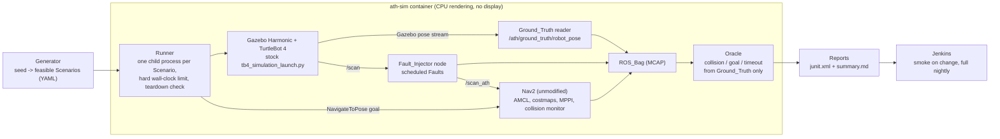

# Autonomy Test Harness

A scenario-based test system for robot navigation. It drives **Nav2** with its minimal TurtleBot 4
simulation (ROS 2 Jazzy, Gazebo Harmonic) through randomized, versioned Scenarios, injects scheduled lidar
Faults between the simulated sensor and Nav2, judges every run from simulator ground truth (never from the
robot's own estimate), and runs headless in Docker under a Jenkins pipeline. The headline result is a
Paired_Experiment: the same Scenarios with no Fault and under each Fault type, with Nav2's pass rate per
condition and a 95% confidence interval.

Code is released under the [MIT License](LICENSE). Third-party packages and images are listed with their licenses in [THIRD_PARTY.md](THIRD_PARTY.md); none are redistributed here. There is no packaging or release.

This README is generated by `python scripts/build_docs.py` from `docs/README.template.md` and the files
under `results/`; every number in it comes from a generated results file.

## Architecture



Nav2 reads the lidar through a parameter file identical to its stock `nav2_params.yaml` except the lidar
topic names, which point at the injector's `/scan_ath`; nothing else about Nav2 or the simulation changes.
Collisions are judged geometrically from true poses and shapes (the model has no contact sensor).

## Scenario format

A Scenario is YAML (`scenarios/example_valid.yaml` is a complete example) with these fields:

| Field | Meaning |
| --- | --- |
| `schema_version` | Format version; an unsupported version is rejected by name |
| `scenario_id` | Name; the bag and the run records are stored under it |
| `seed` | This Scenario's own seed; regenerates it alone |
| `world` | Arena (`empty_10x10`, a walled square arena with a matching map) |
| `time_limit_s` | Simulation seconds after goal dispatch within which the goal must be reached |
| `start`, `goal` | `{x, y, yaw}` in the map frame (equal to the Gazebo world frame), meters and radians |
| `obstacles` | Each `{shape: box or cylinder, size, pose}`; spawned at run time and not on Nav2's map |
| `faults` | Each `{type, window: {start_s, end_s}, params}`; the window is simulation seconds after dispatch |

`harness/schema/scenario.py` defines the bounds; anything out of bounds, of the wrong type, missing, unknown,
or of an unsupported version or world is rejected with an error naming the field.

The Generator (`python -m harness.generator.cli generate --config <yaml> --out <dir> --prefix <id>`) draws
obstacles, start, and goal from a seed, rejects infeasible draws by reason (start inside an inflated
obstacle, off the map, or goal unreachable by a 4-connected flood fill on the inflated grid), and writes
each Scenario with its own seed so it can be regenerated and re-run alone.

## Run locally

Everything that touches ROS, Gazebo, or Nav2 runs in the `ath-sim` image (WSL 2 with Docker Engine on
this machine). Shell scripts run as `bash scripts/<name>.sh` from WSL.

```bash
bash scripts/build_image.sh                     # ath-sim:dev from the working tree
bash scripts/test_unit.sh                       # unit and property tests in the image, with coverage
bash scripts/build_image.sh --tag ath-sim:$(git rev-parse HEAD)   # reported runs use a clean commit
bash scripts/run_suite.sh smoke                 # the Smoke_Suite (scenarios/fixed10)
bash scripts/run_suite.sh full                  # the Full_Suite (fixed10 + experiment30, no Faults)
bash scripts/run_experiment.sh                  # the Paired_Experiment (resumable)
bash scripts/rerun_one.sh --config config/generator.yaml --seed <seed> [--condition <name>]
```

## Run in Jenkins

`bash scripts/jenkins_up.sh` builds and starts a local controller (Compose project `ath-jenkins`) at
http://127.0.0.1:8091/ with anonymous read-only access; it is configured entirely from `ci/jenkins/`
(Configuration as Code, pinned plugins). The job `autonomy-test-harness` runs `ci/Jenkinsfile` from
`file:///repo` (this repository, mounted read-only): it polls for changes every few minutes and runs nightly.
Each build builds `ath-sim:<commit>`, runs the unit tests in it, then runs the Smoke_Suite (on a change) or
the Full_Suite (on the timer), publishes the JUnit reports (one test case per Scenario), and archives the
summary and the bags of failed runs. It fails if a unit test fails, a Scenario errors, or a Smoke_Suite
Scenario fails its Verdict. The evidence of a green build, a deliberately red build, and its revert is in
`ci/jenkins_run_log/`.

## Test commands

These are the commands the pipeline runs (it adds `--image ath-sim:<commit> --baked` and output paths):

```bash
bash scripts/test_unit.sh
bash scripts/run_suite.sh smoke
```

## Results

### Paired_Experiment

{{EXPERIMENT_TABLE}}

{{EXPERIMENT_STAMP}}

What the logs show for the two conditions that stop new scans: under whole-scan dropout and frozen scans,
Nav2's controller aborted the goal with `Unable to transform goal pose into costmap frame`, because the
`map` to `odom` transform had gone stale (`docs/evidence/experiment/scan_dropout_abort_log.txt`,
`docs/evidence/experiment/freeze_abort_log.txt`). AMCL publishes that transform when it processes a new scan,
so when no new scan arrives the controller can no longer place the goal and gives up, rather than continuing
on odometry. The Oracle records these as `timeout` (goal not reached) with Nav2's `ABORTED` in the detail.

Under range noise and the forward sector blackout, several runs failed although Nav2 reported `SUCCEEDED`:
the Fault had pulled AMCL's estimate away from the true pose, so Nav2 stopped where it believed the goal was
while the robot was outside the Oracle's tolerance. A check based on the robot's own estimate would have
passed those runs; judging from Ground_Truth is what catches them (failed-runs table in `results/summary.md`).

### Smoke_Suite stability (M2)

{{M2_SUMMARY}}

### Fault injection check (M3)

{{M3_SUMMARY}}

### Platform baseline (M0) and headless rendering (M4)

{{M0_SUMMARY}}

{{RENDER_SUMMARY}}

## Known limitations

- **The injected faults are models, not field data.** They are simple, seeded lidar perturbations applied
  between the simulated sensor and Nav2; real sensor failures look different.
- **Software rendering.** Sensors render on the CPU with Mesa (`llvmpipe`); lidar geometry is exact, but timing
  differs from a GPU setup.
- **Not bit-for-bit repeatable.** Gazebo and Nav2 timing vary between runs of the same Scenario; the M2 triple
  run reports how often outcomes changed.
- **No contact sensor.** The TurtleBot 4 model has none, so collisions are decided from true poses and shapes
  with a clearance threshold.
- **One arena, one robot, one parameter set.** Results describe Nav2's stock TurtleBot 4 configuration in one
  walled arena with obstacles that are not on the map.
- **Image rebuilds age.** Pinned ROS package versions disappear from the ROS apt repository after its next
  sync; the image recorded for each run identifies what was tested.
- **Odometry drift is not implemented**: intercepting odometry and TF would change the simulation's wiring
  rather than use Nav2's published interfaces.

Versions with evidence are in `docs/ENVIRONMENT.md`; third-party licenses are in `THIRD_PARTY.md`.

## How this was built

This project was built with Claude Code (Anthropic's agentic coding tool) under a spec-driven workflow: written requirements, then a design, then a task list organized into milestones (the spec files under `.kiro/specs/`), each milestone ending in an automated gate script that had to pass before the next one started. The commit history shows this openly; commits carry a `Co-Authored-By` trailer naming the model that helped write them. Every reported number comes from a script in this repository and records the command, seed and commit that produced it, so nothing was typed, estimated or borrowed. I set the goals and constraints in the specification, I am accountable for the verification and the results, and I can explain and change any part of this code.
